# LAB: EXTI & SysTick(eval board)

**Date:** 2026-10-07

**Author/Partner:** Juyoung Lee

**Github:** [22200576-JUYOUNG-LEE/EC-STM32F4-22200576: Firmware for STM32F4, Embedded Controller, HGU](https://github.com/22200576-JUYOUNG-LEE/EC-STM32F4-22200576)

**Demo Video:** [Youtube link](https://youtube.com/shorts/34tNeJ3PVM4)

### Introduction

In this lab, the External Interrupt (EXTI) and SysTick timer of the STM32F411 MCU were studied. Two programs were implemented using interrupts. First, an LED on the NUCLEO-64 board was controlled by an external interrupt from the user button using the Arduino framework. Second, a 0–59 counter on a two-digit 7-segment display was implemented, where the count increases every 1 second based on SysTick, and two push buttons on the JKIT pause/resume and reset the counter through EXTI.

***

## Problem 0: STM-Arduino

A simple program was created that turns the LED (LD2) on and off, triggered by an **External Interrupt** of the user button (BT1) on the NUCLEO-64 board (not on the JKIT).

```c
const int btnPin = 3;
const int ledPin =  13; 

int btnState = HIGH;

void setup() {
    pinMode(ledPin, OUTPUT);
    pinMode(btnPin, INPUT_PULLUP);
    attachInterrupt(digitalPinToInterrupt(btnPin), blink, CHANGE);
}

void loop() {
    // blank
}


void blink(){
    btnState = digitalRead(btnPin);

    if (btnState == HIGH)
        digitalWrite(ledPin, LOW);
    else 
        digitalWrite(ledPin, HIGH);
}
```
#### <font color="#205867">Results</font>

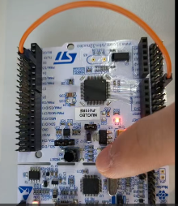

**Demo Video:** [Youtube link](https://youtube.com/shorts/34tNeJ3PVM4)


#### Comparison with the polling method in GPIO

- **Polling (GPIO lab):** The button state is read repeatedly inside `loop()` with `digitalRead()`, and the LED is updated on every iteration. The CPU is always busy checking the input, and a button change can be missed or detected late if other tasks or delays are running in the loop.
- **Interrupt (this lab):** `loop()` is empty. The button pin is registered with `attachInterrupt()` in `CHANGE` mode, so the ISR `blink()` is executed only when the pin level changes (both rising and falling edges). The LED reacts immediately to the button, and the CPU is free to do other work while no event occurs.
- As a result, the interrupt method gives a faster and more reliable response with less CPU load, while the polling method is simpler to write but less efficient.

***


## Problem 1: Counter on 7-Segment display using EXTI

#### Problem Discription

* Count up at the rate of 1 sec.
* Pause the counting when SW2 is pressed.
* Reset to zero when the push button SW1 is pressed.
* The count-up range is extended from 0–9 to **0–59** using two 7-segment digits (the demo video shows counting from 0 to 59).

#### Configuration

Configure the MCU GPIO

| Function                           | Port - Pin                                                   | Configuration                                 |
| ---------------------------------- | ------------------------------------------------------------ | --------------------------------------------- |
| **Button (SW1) on JKIT**           | PD\_2                                                        | DIN, Pull-Up                                  |
| **Button (SW2) on JKIT**           | PA\_4                                                        | DIN, Pull-Up                                  |
| **7-Segment DOUT**                 | PB\_0, PB\_1, PB\_2, PB\_3, PB\_4, PB\_5, PB\_6, PB\_7('a'\~'g''dot', respectively) | Push-Pull, No Pull-up-Pull-down, Medium Speed |
| **Selection of 7-Segment Display** | PA\_10 (FND\_0)                                              | DOUT, Push-Pull,                              |

#### Circuit Diagram


#### Code
- **define**
  - **NUM_STATE_EXTI_1:** Total number of display states (0 to 9)
  
- **Global Variables**
  
    - **numDisplay1, numDisplay2:** Numerical values to display on digit 1 (units) and digit 2 (tens)
      
    - **selectFND1, selectFND2:** Digit selector indices corresponding to display 1 and display 2
      
    - **state:** Current counter value/state (0 to 9)
      
    - **pause:** Toggle flag for counter control (0: counting, 1: paused)
      
    - **curTicks:** Saved tick timestamp used for non-blocking 1-second timing
    
- **setup()**
  
    - **Initializes (`MCU_JK_init()`):**
      
        - Initializes the PLL system clock (84 MHz) and SysTick timer (1 ms)
          
        - Initializes segment pins (`pinFND`) and digit selector pins (`selectFND`)
          
        - Initializes switch input pins (`SW1_PIN_JK`, `SW2_PIN_JK`) with pull-up configuration
          
        - Initializes external interrupts (EXTI) for SW1 (`PD_2`) and SW2 (`PA_4`)
        
    - Saves current tick count (`curTicks = msTicks`) to synchronize timing
    
- **main()**
  
    - Calls `setup()` and enters the infinite loop (`while (1)`):
      
    - **1) Write (7-Segment Display Multiplexing):**
      
        - Calculates unit digit (`state % 10`) and tens digit (`state / 10`).
          
        - Multiplexes and displays `numDisplay1` on FND 1 for 5 ms, then `numDisplay2` on FND 2 for 5 ms (`delay_ms(5)`).
        
    - **2) Update (Counter Logic):**
      
        - Measures elapsed time without blocking CPU execution using `(msTicks - curTicks)`.
          
        - If 1000 ms (1 sec) has elapsed and the system is not paused (`pause == 0`), increments `state` modulo `NUM_STATE_EXTI_1` and resets `curTicks` to `msTicks`.
    
- **EXTI Interrupt Handlers**
  - **`EXTI4_IRQHandler()` (SW2 - Pause/Resume):**
  
    - Triggers when SW2 (`PA_4`) button is pressed (falling edge).
    - Toggles the `pause` state variable (`pause ^= 1`).
  
    - Updates `curTicks = msTicks` so that timing restarts cleanly upon resume without an immediate count jump.
  
    - Clears the pending interrupt flag via `clear_pending_EXTI(SW2_PIN_JK)`.
  
    
  
  - **`EXTI2_IRQHandler()` (SW1 - Reset):**
  
      - Triggers when SW1 (`PD_2`) button is pressed (falling edge).
        
      - Resets the counter state back to zero (`state = 0`).
        
      - Updates `curTicks = msTicks` to align the 1-second timer from the reset moment.
        
      - Clears the pending interrupt flag via `clear_pending_EXTI(SW1_PIN_JK)`.


```c
/*----------------------------------------------------------------\
@ Embedded Controller by Young-Keun Kim - Handong Global University
Author           : Juyoung Lee
Created          : 05-03-2021
Modified         : 10-07-2026
Language/ver     : C++ in VS Code

Description      : Counter on 7-Segment display using EXTI
/----------------------------------------------------------------*/

#include "ecSTM32F4v2.h"

extern volatile uint32_t msTicks;

uint8_t numDisplay1     = 0;
uint8_t numDisplay2     = 0;
uint8_t selectFND1      = 0;
uint8_t selectFND2      = 1;

uint8_t state           = 0;
uint8_t pause           = 0;

volatile uint32_t curTicks = 0;

// Initialiization 
void setup(void)
{
    MCU_JK_init();	

    curTicks = msTicks;
    
}


// MAIN  ----------------------------------------
int main(void) {
	setup();

	while (1){

        // 1) Write
        numDisplay1 = state % 10;
        numDisplay2 = state / 10;

        FND_select(selectFND1);
        FND_display(numDisplay1);
        delay_ms(5);

        FND_select(selectFND2);
        FND_display(numDisplay2);
        delay_ms(5);
        
        // 2) Update
        if(((msTicks - curTicks) > EXTI_TIME_PREIOD) && (pause == 0)){

            state = (++state) % EXTI_NUM_STATE;

            curTicks = msTicks;
        }
    }
}

void EXTI4_IRQHandler(void) {

	if (is_pending_EXTI(SW2_PIN_JK)) {   

        pause ^= 1;
        curTicks = msTicks;

        clear_pending_EXTI(SW2_PIN_JK);
	}
}

void EXTI2_IRQHandler(void) {

    if (is_pending_EXTI(SW1_PIN_JK)) {   

        state = 0;    
        curTicks = msTicks;
        
		clear_pending_EXTI(SW1_PIN_JK);
	}

}


```

#### Results

count up 0 to 9
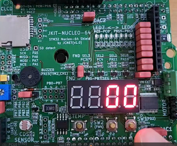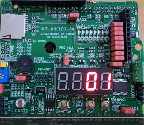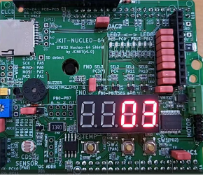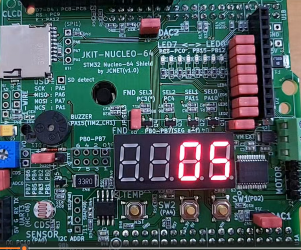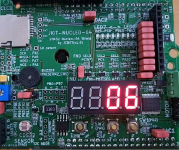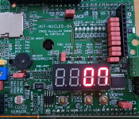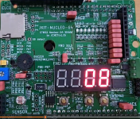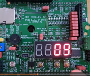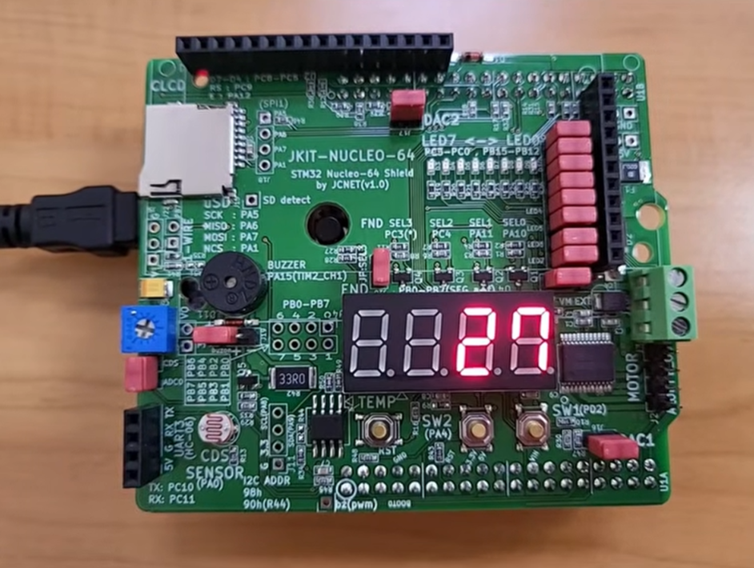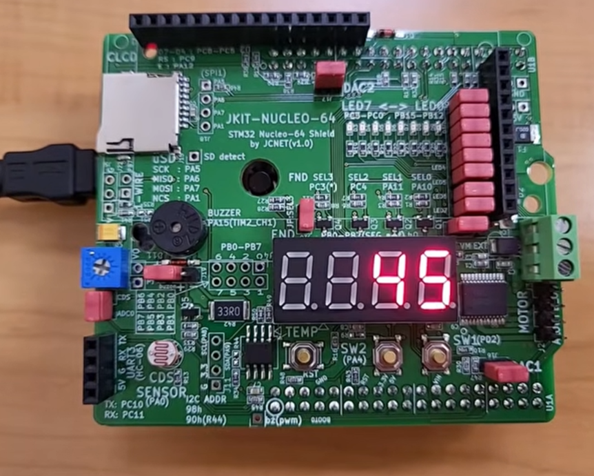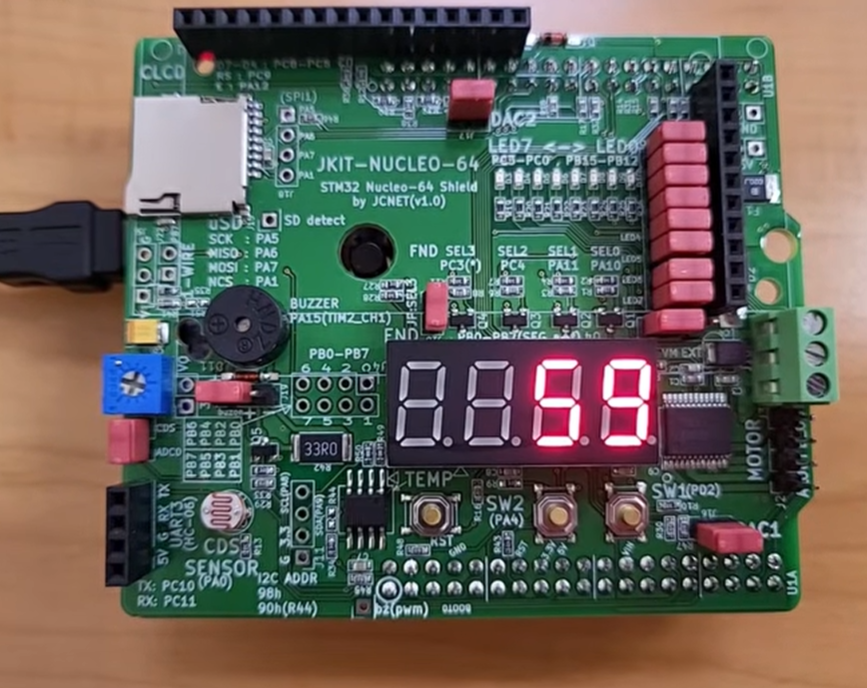

**Demo Video:** [Youtube link](https://youtube.com/shorts/34tNeJ3PVM4)

#### Discussion

1. Analyze the result and explain any other necessary discussion.

> - **Timer & Display**: Non-blocking timing with `msTicks` ensures accurate 1-second counting, while 5 ms multiplexing provides a flicker-free display via Persistence of Vision (POV).

- **Interrupt Control**: EXTI provides instant responses for SW2 (Pause/Resume) and SW1 (Reset). Re-synchronizing `curTicks` inside the ISRs prevents immediate time jumps upon resuming.
  
- **Button Bouncing**: Lack of hardware/software debouncing may cause occasional double-triggering due to mechanical switch chatter.

2. We can use two different methods to detect an external signal: polling and interrupt. What are the advantages and disadvantages of each approach?

> - **Polling**: Simple and easy to implement, but inefficient (100% CPU usage) and risks missing fast inputs during delays.

- **Interrupt**: Highly CPU-efficient with real-time response to asynchronous events, but increases logic complexity and requires `volatile` for shared variables.

3. What would happen if the EXTI interrupt handler does not clear the interrupt pending flag? Check with your code

>- Without `clear_pending_EXTI()`, the pending bit in `EXTI->PR` remains set (`1`).

- The NVIC continuously re-triggers the interrupt, trapping the MCU in an **infinite ISR loop**.
  
- Program execution never returns to `main()`, completely freezing both the 7-segment display and counter logic.

modified code for checking uncleared pending flag
```c 

[others are same]

void EXTI2_IRQHandler(void) {

    if (is_pending_EXTI(SW1_PIN_JK)) {   

        state = 0;    
        curTicks = msTicks;

	}

}
```

**Demo Video:** https://youtu.be/eaapB1Z1Wz8

### Reference

Complete list of all references used (github, blog, paper, etc)

STMicroelectronics, _STM32F411xC/E Reference Manual (RM0383)_, Rev 4, 2025. [Online]. Available: [STMicroelectronics RM0383](https://www.st.com/resource/en/reference_manual/rm0383-stm32f411xce-advanced-armbased-32bit-mcus-stmicroelectronics.pdf)

