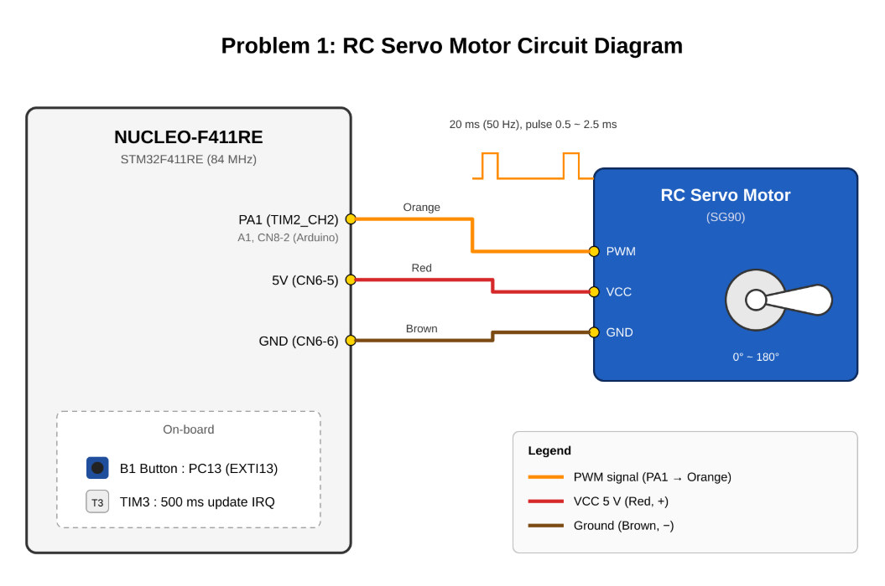
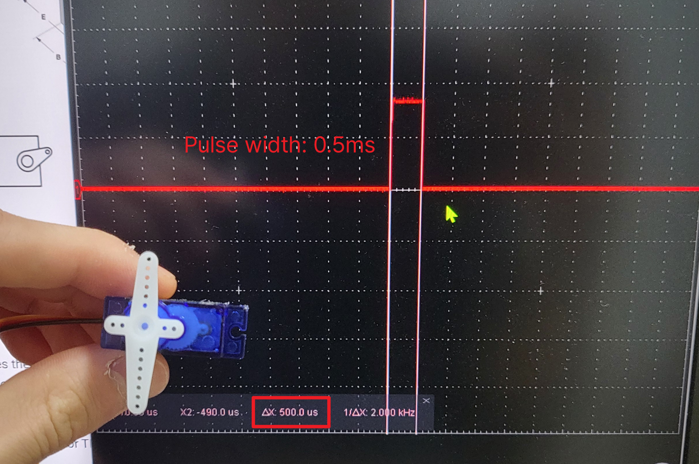
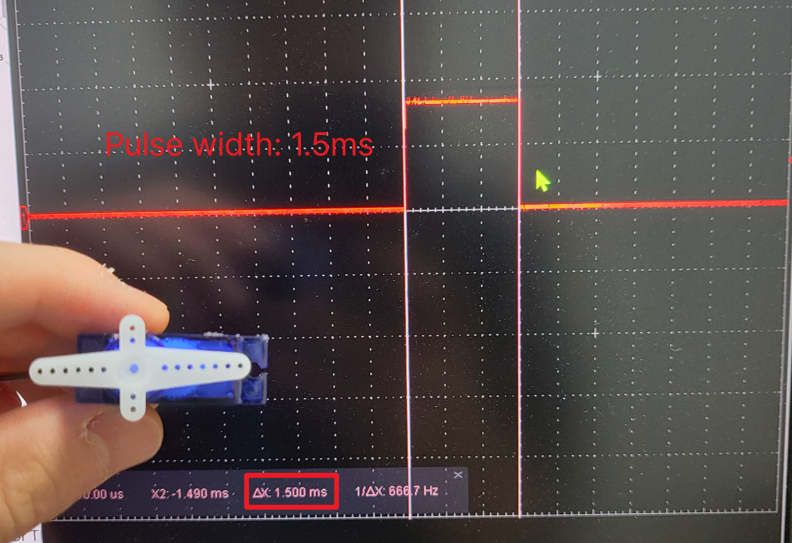
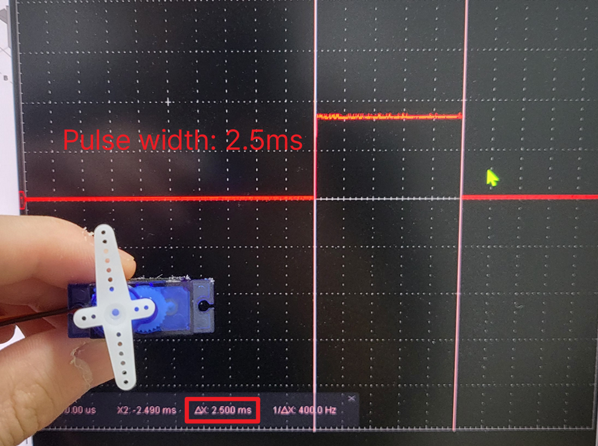
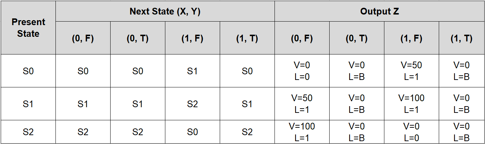
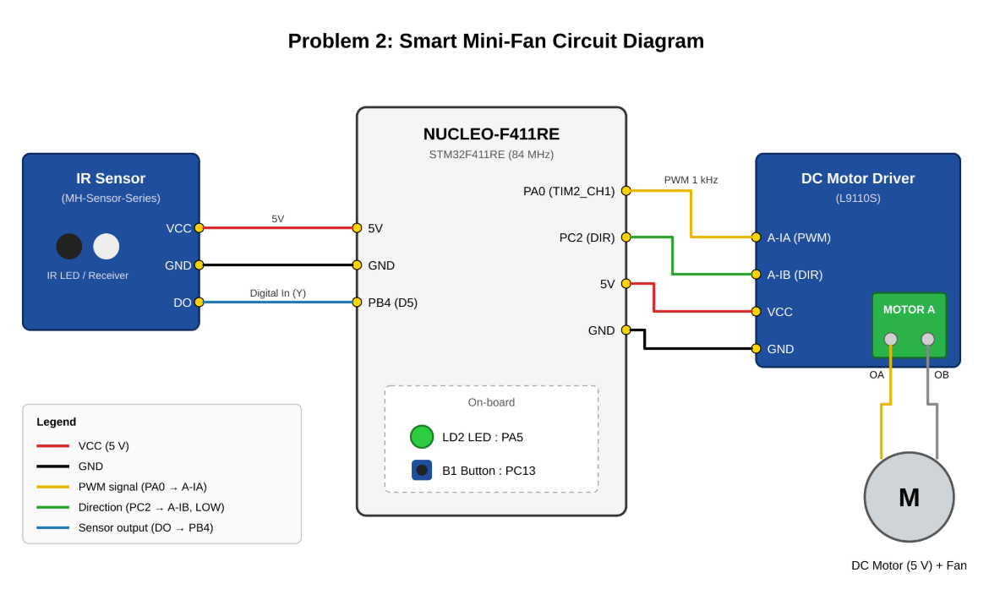
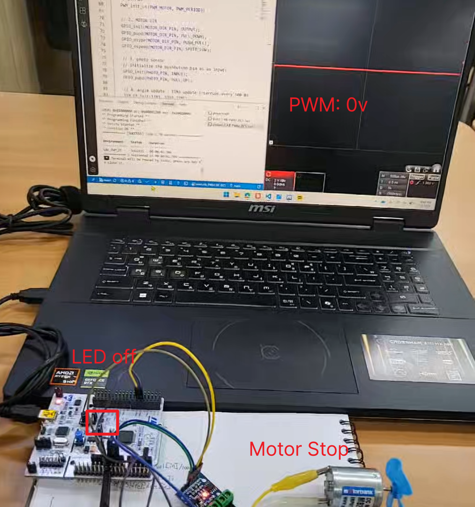
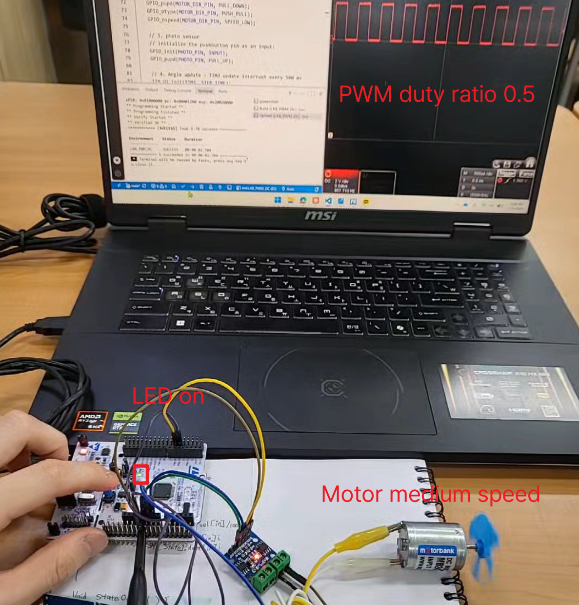
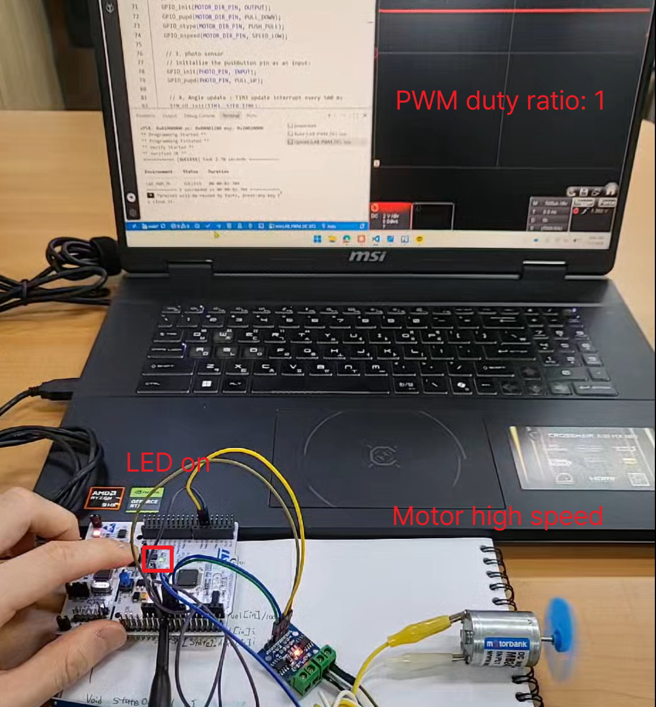
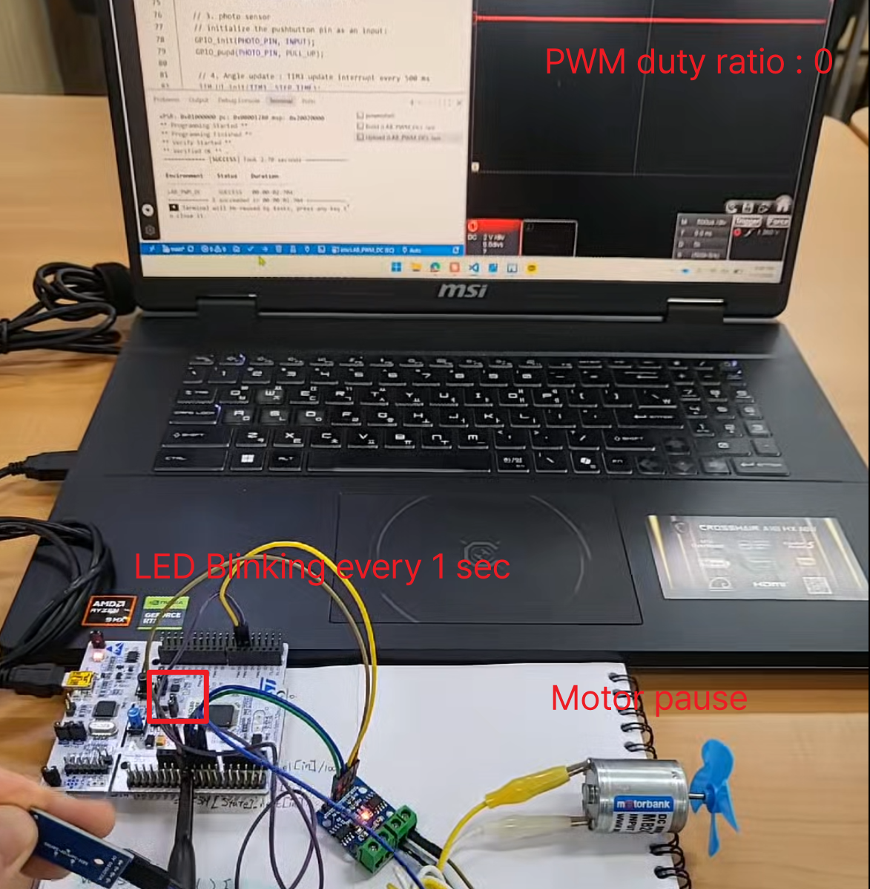

# LAB: Timer & PWM

**Date:** 2026-11-07

**Author/Partner:** Juyoung Lee

**Github:** [22200576-JUYOUNG-LEE/EC-STM32F4-22200576: Firmware for STM32F4, Embedded Controller, HGU](https://github.com/22200576-JUYOUNG-LEE/EC-STM32F4-22200576)

**Demo Video:** 

## Introduction

Create a simple program that control a sevo motor and a DC motor with PWM output.


### Requirement

**Hardware**

* MCU
  * NUCLEO-F411RE
* Actuator/Sensor/Others:
  * RC Servo Motor (SG90)
  * DC motor (5V)
  * DC motor driver(LS9110s or L298N)

**Software**

* PlatformIO, CMSIS, EC\_HAL library

***

## Problem 1: RC servo motor

An RC servo motor is a lightweight motor with high output power. It is used to control rotation angles of approximately 180 degrees (90 degrees in each direction) and is commonly applied in RC cars and small-scale robots. The angle of the motor can be controlled by the pulse width (duty ratio) of a PWM signal. The PWM period should be set to 20ms (or 50Hz). Refer to the datasheet of the RC servo motor for detailed specifications


Make a simple program that changes the angle of the RC servo motor that rotates back and forth from 0 deg to 180 degree within a given period of time.

* Connect the RC servo motor to MCU pin (PA1) , VCC and GND
  * Use Port A Pin 15 as PWM output pin for TIM2\_CH1.
  * Use Timer interrupt of period 500msec.
* Increase the angle of RC servo motor from 0° to 180° with a step of 10° every 500msec.
* After reaching 180°, decrease the angle back to 0°.
  * Use timer interrupt IRQ.
* When the user button (PC_13) is pressed, it should reset to the angle 0° and start over.
  * Use EXT interrupt.

#### Configuration

| Type                       | Port - Pin      | Configuration                                  |
| -------------------------- | --------------- | ---------------------------------------------- |
| **Button**                 | PC13            | DIN, Pull-Up                                   |
| **PWM**                    | TIM2\_CH1 (PA1) | TIM2 (PWM) period: 20msec, Duty : 0.5\~2.5msec |
| **Timer Update Interrupt** | TIM3            | TIM3: Timer Interrupt of 500 msec              |

#### Circuit Diagram



#### Code

- `angle2pulse_us()`: Converts an angle [deg] to a PWM pulse width [µs] with linear mapping, 0° → 500 µs and 180° → 2500 µs. Using integer math gives an exact pulse width at every 10° step. For example, 90° gives 1500 µs.
- `setup()`: `MCU_init()` sets the system clock to PLL 84 MHz and SysTick to 1 ms, and sets up the user button (PC13). The function then:
  - Starts the PWM on PA1 (TIM2_CH2) with a 20 ms period (50 Hz).
  - Sets the first pulse width to 0.5 ms so the servo starts at 0°.
  - Starts the TIM3 update interrupt every 500 ms (priority 2, lower than the button).
  - TIM2 is used only for PWM and TIM3 only for the timer interrupt, so the two do not interfere with each other.
- `main()`: Runs `setup()` and then waits in an empty loop. All the work is done in the interrupt handlers (TIM3 and EXTI).
- `TIM3_IRQHandler()`: Every 500 ms it changes the angle by 10° in the current direction (`dir`). When the angle reaches 180°, the direction changes to decreasing. When it reaches 0°, the direction changes back to increasing. The servo therefore sweeps back and forth between 0° and 180°. The new pulse width is applied with `PWM_pulsewidth_us()`, and the update flag is cleared.
- `EXTI15_10_IRQHandler()`: When the B1 button (PC13, EXTI line 13) is pressed, it resets the angle to 0° and the direction to increasing, and immediately sets the pulse width to 0.5 ms. Setting `TIM3->CNT = 0` restarts the 500 ms count, so the next 10° step comes exactly 500 ms after the button press.
- `angle` and `dir` are shared by both ISRs, so they are declared `volatile` so the compiler always reads their current values from memory.

```c
/*----------------------------------------------------------------
@ Embedded Controller by Young-Keun Kim - Handong Global University
Author           : Juyoung Lee
Created          : 10-13-2026
Modified         : 11-02-2026
Language/ver     : C in VS Code (PlatformIO)

Description      : LAB - PWM RC Servo Motor (SG90)
                   - PWM   : PA_1 (TIM2_CH1), period 20 ms (50 Hz),
                             pulse 0.5 ~ 2.5 ms  (0 ~ 180 deg)
                   - TIM3  : Update interrupt every 500 ms
                             angle 0 -> 180 -> 0, step 10 deg
                   - EXTI  : User button (PC13) -> reset to 0 deg
/----------------------------------------------------------------*/

#include "ecSTM32F4v2.h"

// ---------------- Pin & Parameter ----------------
#define PWM_MOTOR     PA_1       // TIM2_CH1 (Configuration table: PA_1 = TIM2_CH2)

#define PWM_PERIOD    20          // [ms]  50 Hz
#define PULSE_MIN_US  500         // [us]  0 deg
#define PULSE_MAX_US  2500        // [us]  180 deg
#define ANGLE_STEP    10          // [deg]
#define STEP_TIME     500         // [ms]  TIM3 update period

// ---------------- Global (shared with ISR) ----------------
volatile int angle = 0;           // current angle [deg]
volatile int dir   = 1;           // +1: increasing, -1: decreasing

// angle [deg] -> pulse width [us]   (integer math, no truncation issue)
uint32_t angle2pulse_us(int deg) {
	return PULSE_MIN_US + (uint32_t)((PULSE_MAX_US - PULSE_MIN_US) * deg / 180);
}

void setup(void) {
	MCU_init();                                    // PLL 84 MHz, SysTick

	// 1. Servo PWM : TIM2 only for PWM (do NOT use TIM2 for UI)
	PWM_init(PWM_MOTOR, PWM_PERIOD);
	PWM_pulsewidth_us(PWM_MOTOR, angle2pulse_us(angle));  // start at 0 deg

	// 2. Angle update : TIM3 update interrupt every 500 ms
	TIM_UI_init(TIM3, STEP_TIME);
	NVIC_SetPriority(TIM3_IRQn, 2);                // lower than button
}

int main(void) {
	setup();

	while (1) {
		// All work is done in interrupts (TIM3, EXTI)
	}
}

// ---------------- TIM3 : every 500 ms, step angle ----------------
void TIM3_IRQHandler(void) {
	if (is_UIF(TIM3)) {
		angle += dir * ANGLE_STEP;

		if (angle >= 180)     { angle = 180; dir = -1; }   // turn back at 180
		else if (angle <= 0)  { angle = 0;   dir = +1; }   // turn back at 0

		PWM_pulsewidth_us(PWM_MOTOR, angle2pulse_us(angle));

		clear_UIF(TIM3);
	}
}

// ---------------- EXTI : button -> reset to 0 deg ----------------
void EXTI15_10_IRQHandler(void) {                  // PC13 -> EXTI line 13
	if (is_pending_EXTI(BUTTON_PIN)) {
		angle = 0;
		dir   = +1;
		PWM_pulsewidth_us(PWM_MOTOR, angle2pulse_us(angle));

		TIM3->CNT = 0;                             // restart 500 ms count from now

		clear_pending_EXTI(BUTTON_PIN);
	}
}
```

#### Results

> **[Figure 1.1]** Minimum pulse - Pulse width 0.5ms
>
> 
>
> **[Figure 1.2]** Neutral position- Pulse width 1.5ms
>
> 
>
> **[Figure 1.3]** Maximum pulse- Pulse width 2.5ms
>
> 


Add [demo video link](https://github.com/ykkimhgu/course-doc/blob/master/ec-course/lab/link/README.md)

#### Discussion

1. Derive a simple logic to calculate CCR and ARR values to generate x\[Hz] and y\[%] duty ratio of PWM. How can you read the values of input clock frequency and PSC?

   > The counter clock is f_CNT = f_CK_PSC / (PSC + 1). One PWM period lasts (ARR + 1) counts, so the frequency gives **ARR = f_CNT / x − 1**. The output is HIGH while CNT < CCR, so the duty ratio gives **CCR = (y / 100) × (ARR + 1)**.
   >
   > For example, with an 84 MHz clock and PSC = 83, f_CNT is 1 MHz. A 50 Hz servo signal then needs ARR = 19999, and CCR = 500 to 2500 gives pulse widths of 0.5 to 2.5 ms.
   >
   > PSC is read directly from the `TIMx->PSC` register. The input clock comes from the RCC registers: the system clock is set by `RCC->CFGR` (SWS) and `RCC->PLLCFGR`, and the bus prescalers by the HPRE and PPRE1/PPRE2 bits. If the APB prescaler is not 1, the timer clock is twice the APB clock. In this lab that gives TIM2 an input clock of 42 MHz × 2 = 84 MHz.
   >
   > 

2. What is the smallest and highest PWM frequency that can be generated for Q1?

   > TIM2 runs at 84 MHz with a 16-bit PSC and a 32-bit ARR, and f_PWM = 84 MHz / [(PSC + 1)(ARR + 1)].
   >
   > The highest frequency comes from PSC = 0 and ARR = 1: **f_max = 42 MHz**. At that setting only 0 %, 50 % and 100 % duty are possible.
   >
   > The lowest frequency comes from PSC = 65535 and ARR = 2³² − 1: **f_min ≈ 2.98 × 10⁻⁷ Hz**
   >
   > Higher frequencies give coarser duty resolution, since the resolution is 1 / (ARR + 1).

***

## Problem 2: DC motor

### Problem

The program needs to design a smart mini-fan device that runs only when the face is near the fan. Otherwise stops the fan from running.

* As the button **B1** is pressed, change the fan velocity Mode.
* The velocity MODE(states) are
  * MODE(state): **OFF(0%), MID(50%), HIGH(100%)**
* PAUSE: When the object(face) is detected neraby, it automatically pauses the fan temporarily.
  * PAUSE: the MODE should NOT be changed if the button **B1** is pressed
* RESUME: When the object(face) is away, it automatically resumes the fan running
  * It must maintain return to the previous MODE run at the speed of the current MODE
* LED
  * MODE=OFF, LED=OFF
  * MODE=MID, HIGH, LED=ON
  * PAUSE, LED=Blinking 1 sec
* Serial Display
  * Print the Mode, PWM duty ratio and other necessary information every 2seconds
* Use FSM to design the code
  * Draw a FSM(finite-state-machine) table and state diagram

> [Table 2.1] FSM
>
> 

#### Configuration

| Function                   | Port - Pin        | Configuration                       |
| -------------------------- | ----------------- | ----------------------------------- |
| **Button**                 | PC13              | DIN, Pull-Up                        |
| **Direction Pin**          | PC2               | DOUT, Push-Pull                     |
| **PWM Timer**              | TIM2\_CH1 (PA\_0) | TIM2 (PWM) period: **1msec (1kHz)** |
| **Timer Update Interrupt** | TIM3              | TIM3: Timer Interrupt of 500 msec   |
| **LED**                    | PA_5              | DOUT, Push_Pull                     |
| **Photo Sensor**           | PB_4              | DIN, Pull-Up                        |

#### Circuit Diagram

> [Circuit Diagram  2.1]  Smart Mini-Fan Circuit Diagram
>
> 


#### Code

- `setup()`: `MCU_init()` sets the system clock to PLL 84 MHz and SysTick to 1 ms, and sets up the user button (PC13) and the LED (PA5). The function then does four things:
  - Starts the PWM on PA0 (TIM2_CH1) with a 1 ms period (1 kHz).
  - Sets the motor direction pin PC2 as a push-pull output.
  - Sets the photo sensor pin PB4 as a pull-up input.
  - Starts the TIM3 update interrupt every 1 ms (priority 2, lower than the button).
- `FSM[3]`: A Mealy-type FSM table with three states: S0 = OFF, S1 = MID, S2 = HIGH. Each state stores the next state, the PWM duty [%] and the LED mode for each of the four inputs. The input index is `X*2 + Y`, where X is a button press and Y is an object nearby.
- `nextState()`: Reads the button event (X) once and then clears it, so one press changes the mode only once. It looks up the current state’s row in the FSM table and updates the output (duty, LED mode) and the next state. When Y = 1 (PAUSE), the next state is the same as the current state, so a button press does not change the mode. The duty is 0 %, so the fan stops. When Y returns to 0 (RESUME), the fan runs again at the duty of the saved mode.
- `stateOutput()`: Holds the direction pin LOW, so the duty ratio is applied to the motor speed directly without inversion. It applies the duty with `PWM_duty()` and turns the LED ON or OFF according to the LED mode. Blinking is handled in the TIM3 ISR.
- `main()`: Prints an initialization message. Every 50 ms the loop reads the photo sensor (Y), runs `nextState()` and `stateOutput()`, and prints the current mode, duty ratio and RUN/PAUSE status when `print_flag` is set.
- `EXTI15_10_IRQHandler()`: When the B1 button (PC13, EXTI line 13) is pressed, it sets `btn_flag = 1` (input X) and clears the pending bit. The mode change itself happens in the main loop through the FSM.
- `TIM3_IRQHandler()`: Runs every 1 ms. In BLINK mode it toggles the LED every 1000 counts (1 s). Every 2000 counts (2 s) it sets `print_flag`, and `printf()` is called in the main loop instead of inside the ISR, so the ISR stays short.

```c
#include "ecSTM32F4v2.h"

// ---------------- Pin & Parameter ----------------
#define PWM_MOTOR       PA_0      // TIM2_CH1 (Configuration table: PA_1 = TIM2_CH2)
#define MOTOR_DIR_PIN   PC_2
#define PHOTO_PIN		PB_4
#define STEP_TIME		1			// [ms]  1000Hz

#define PWM_PERIOD      1000        // [us]  1000Hz

// ---- State ----
#define S0 		0	// OFF
#define S1 		1	// MID
#define S2 		2 	// HIGH

// ---- LED output codes ----
#define L_OFF   0
#define L_ON    1
#define L_BLINK 2

typedef struct {
    uint32_t next[4];   // next state for input index 0~3
    uint32_t vel[4];    // duty [%]
    uint32_t led[4];    // LED mode
} State_t;

// input index = X*2 + Y  →  (0,F)=0, (0,T)=1, (1,F)=2, (1,T)=3
State_t FSM[3] = {
    //   next              vel             led
    { {S0,S0,S1,S0}, {  0,0, 50,0}, {LOW,L_BLINK,L_ON, L_BLINK} },  // S0
    { {S1,S1,S2,S1}, { 50,0,100,0}, {L_ON, L_BLINK,L_ON, L_BLINK} },  // S1
    { {S2,S2,S0,S2}, {100,0,  0,0}, {L_ON, L_BLINK,L_OFF,L_BLINK} },  // S2
};

volatile uint32_t state    = S0;
volatile uint32_t btn_flag = 0;     // X (set in EXTI)
volatile uint32_t obj_near = 0;     // Y
volatile uint32_t led_mode = L_OFF;
volatile float    duty     = 0.0f;
volatile uint32_t print_flag = 0;

// ---- FSM core ----
void nextState(void) {
    uint32_t X = btn_flag;  btn_flag = 0;     // consume button event once
    uint32_t Y = obj_near;
    uint32_t in = X * 2 + Y;

    duty     = FSM[state].vel[in] / 100.0f;   // output
    led_mode = FSM[state].led[in];
    state    = FSM[state].next[in];           // transition
}

void stateOutput(void) {
    GPIO_write(MOTOR_DIR_PIN, LOW);           // DIR LOW → duty = speed (no inversion)
    PWM_duty(PWM_MOTOR, duty);

    if (led_mode == L_OFF) GPIO_write(LED_PIN, LOW);
    if (led_mode == L_ON)  GPIO_write(LED_PIN, HIGH);
    // L_BLINK is handled in TIM3 ISR
}

void setup(){

    MCU_init();

	// 1. PWM 
	PWM_init_us(PWM_MOTOR, PWM_PERIOD);

    // 2. MOTOR DIR 
    GPIO_init(MOTOR_DIR_PIN, OUTPUT);
    GPIO_pupd(MOTOR_DIR_PIN, PULL_DOWN);
    GPIO_otype(MOTOR_DIR_PIN, PUSH_PULL);
    GPIO_ospeed(MOTOR_DIR_PIN, SPEED_LOW);

	// 3. photo sensor
    // initialize the pushbutton pin as an input:
	GPIO_init(PHOTO_PIN, INPUT);  
	GPIO_pupd(PHOTO_PIN, PULL_UP);
    
	// 4. Angle update : TIM3 update interrupt every 500 ms
	TIM_UI_init(TIM3, STEP_TIME);
	NVIC_SetPriority(TIM3_IRQn, 2);                // lower than button
}

int main(void) {
	setup();
	printf("EC_LAB_PWM_DC_22200576 Initialized!\r\n");

	while (1) {
        obj_near = GPIO_read(PHOTO_PIN);  // Y
        nextState();
        stateOutput();

        if (print_flag) {                     // print outside ISR
            printf("MODE=S%ld  duty=%.2f  %s\r\n",
                   state, duty, obj_near ? "PAUSE" : "RUN");
            print_flag = 0;
        }
        delay_ms(50);
    }
}

// ---------------- EXTI : button -> reset to 0 deg ----------------
void EXTI15_10_IRQHandler(void) {                  // PC13 -> EXTI line 13
	if (is_pending_EXTI(BUTTON_PIN)) {

        btn_flag = 1;

		clear_pending_EXTI(BUTTON_PIN);
	}
}

// ---- 1 ms timer: blink + 2 s print ----
void TIM3_IRQHandler(void) {
    static uint32_t blink_cnt = 0, print_cnt = 0;
    if (is_UIF(TIM3)) {
        if (led_mode == L_BLINK && ++blink_cnt >= 1000) {
            GPIO_write(LED_PIN, !GPIO_read(LED_PIN));
            blink_cnt = 0;
        }
        if (++print_cnt >= 2000) { print_flag = 1; print_cnt = 0; }
        clear_UIF(TIM3);
    }
}
```

#### Results

> **[Figure 2.1]** DC Motor Mode off - Motor stop, LED off
>
> 
>
> **[Figure 2.2]** DC Motor Mode mid - Motor medium speed , LED on
>
> 
>
> **[Figure 2.3]** DC Motor Mode high - Motor high speed, LED on
>
> 
>
> **[Figure 2.4]** DC Motor Mode pause - Motor pause, LED blinking
>
> 

Add [demo video link](https://github.com/ykkimhgu/course-doc/blob/master/ec-course/lab/link/README.md)

### Reference

```
[1] STMicroelectronics, "RM0383 Reference manual: STM32F411xC/E advanced Arm®-based 32-bit MCUs," Rev. 4, May 2025. [Online]. Available: https://www.st.com
[2] STMicroelectronics, "PM0214 Programming manual: STM32 Cortex®-M4 MCUs and MPUs programming manual," Rev. 10, Mar. 2020. [Online]. Available: https://www.st.com
```

## Troubleshooting

#### 1. motor PWM duty ratio for different DIR

When, DIR=0 duty=0.8--> PWM 0.8 // 실제 모터에 전달되는 pwm

Whe, DIR=1 duty=0.8--> PWM 0.2 // 실제 모터에 전달되는 PWM

* Sample Solution

```c++
float targetPWM;  // pwm for motor input 
float duty=abs(DIR-targetPWM); // duty with consideration of DIR=1 or 0

PWM_duty(PWM_PIN, duty);
```

#### 2. Motor does not run under duty 0.5

Configure motor PWM period above 1kHz

#### 3. Check and give different Interrupt Priority

Check if you have different NVIC priority number for each IRQs
