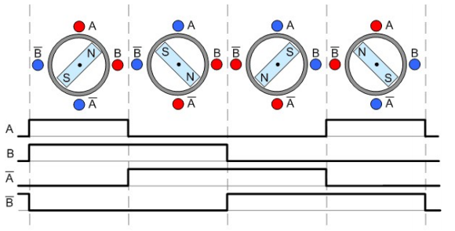
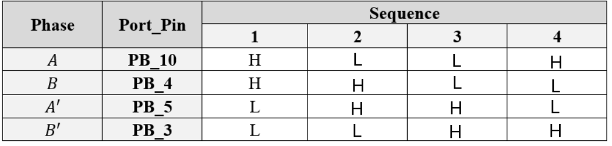
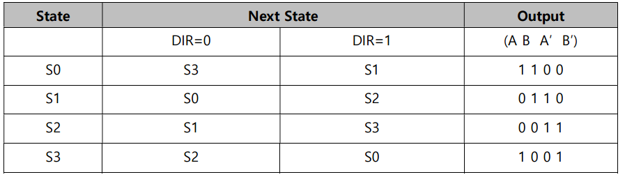
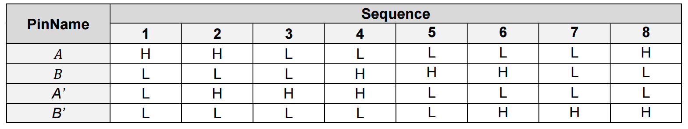
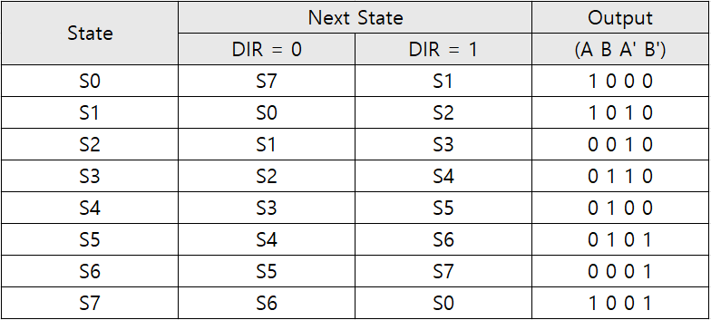
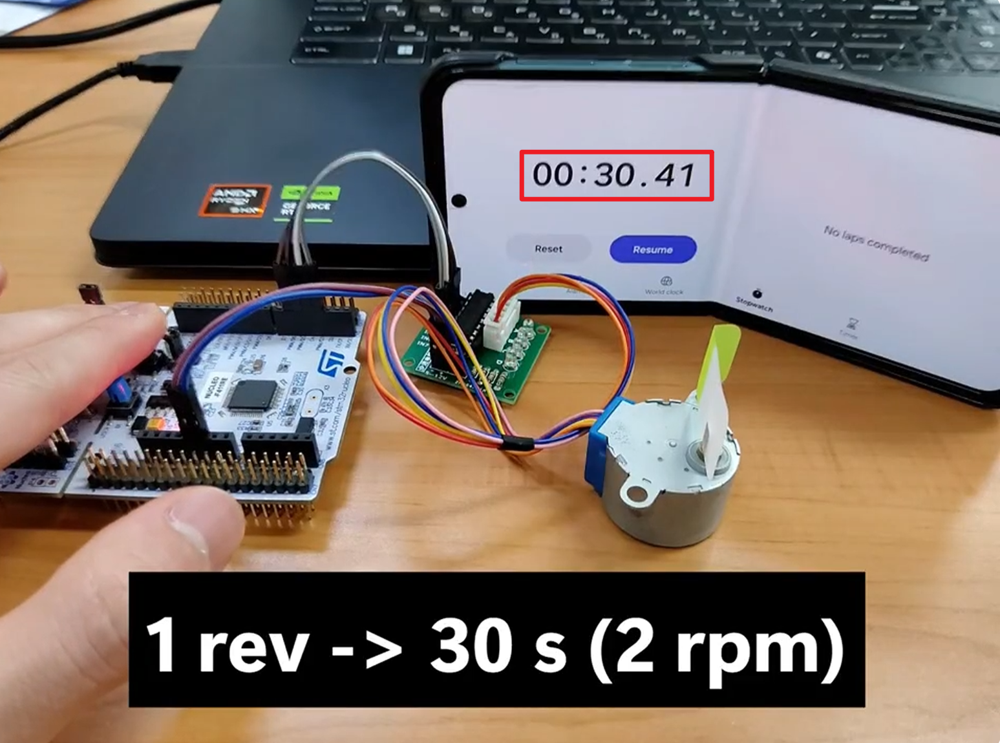
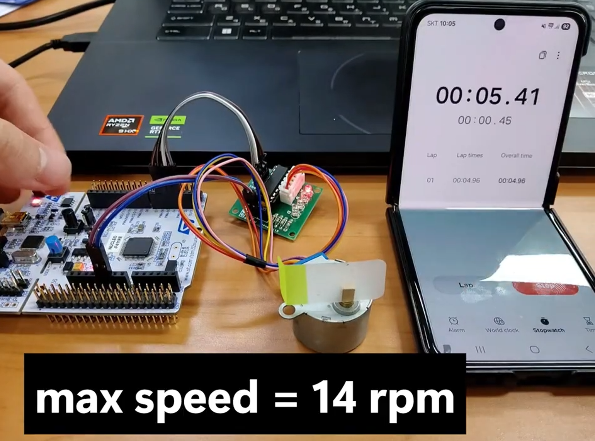
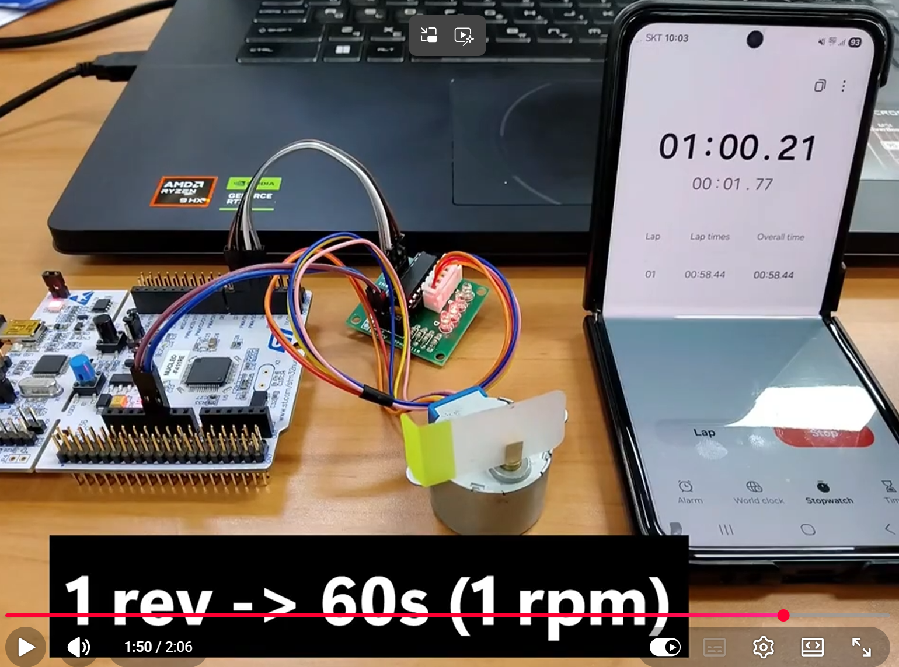
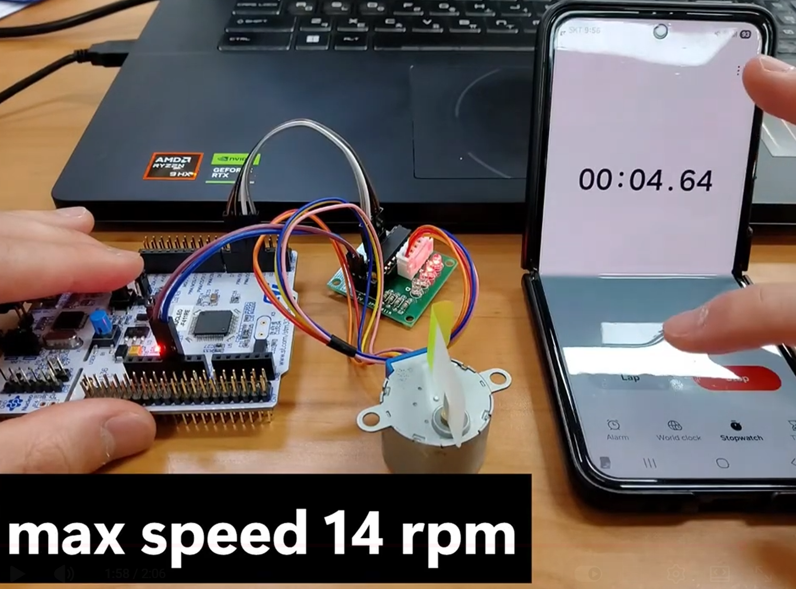

# LAB: Stepper Motor

## LAB: Stepper Motor

**Date:** 2026-10-09

**Author/Partner:** Juyoung Lee

**Github:** [22200576-JUYOUNG-LEE/EC-STM32F4-22200576: Firmware for STM32F4, Embedded Controller, HGU](https://github.com/22200576-JUYOUNG-LEE/EC-STM32F4-22200576)

**Demo Video:** [[EC 26-2] LAB(Stepper Motor)](https://www.youtube.com/watch?v=ZQgBbO_29qM)

### Introduction

In this lab, a 28BYJ-48 unipolar stepper motor was driven through a ULN2003 driver using a Moore finite state machine (FSM). A stepper motor library (`ecStepper2.h/.c`) was implemented that supports full-stepping and half-stepping, rotation direction control, and speed setting in RPM. The rotation time was measured to verify the speed calculation, the maximum and minimum operating speeds were investigated, and an external interrupt (EXTI) was used to stop the motor with a push button.

#### Requirement

**Hardware**

* MCU: NUCLEO-F411RE
* Actuator: Stepper Motor 28BYJ-48 (5V, unipolar)
* Motor Driver: ULN2003

**Software**

* PlatformIO, CMSIS, EC_HAL library


**Circuit Diagram for forward Project**


<figure><figcaption></figcaption></figure>


___

## Problem : Stepper Motor Control with FSM

### Problem Description

1. Rotate the stepper motor 5 revolutions with 1 rpm.
2. Repeat the above process in the opposite direction.
3. Increase and decrease the speed of the motor as fast as it rotate to find the maximum and minimum speed of the motor.
4. Apply the half-stepping and repeat the above.

* **Driver:** **ULN2003 motor driver.**[ULN2003 spec sheet](https://www.electronicoscaldas.com/datasheet/ULN2003A-PCB.pdf)
* **Motor:** 28BYJ-48, Search for the spec sheet
* **Number of Step:** 2048 per revolution (Stride step(64) * Gear ratio(32)

  

#### Configuration

| Function                         | Port - Pin                                | Configuration                                            |
| -------------------------------- | ----------------------------------------- | -------------------------------------------------------- |
| **Stepper Motor (A, B, A', B')** | PB_10, PB_4, PB_5, PB_3 (ULN2003 IN1–IN4) | Digital Out, Push-Pull, No Pull-up-Pull-down, Fast Speed |
| **Button (SW1)**                 | SW1_PIN (PC_13, user button)              | Digital In, EXTI15_10, Falling edge, Priority 10         |
| **System Clock / Timer**         | PLL 84 MHz, SysTick                       | 1 ms tick (`delay_ms()`)                                 |


#### Connection Diagram

<figure><figcaption></figcaption></figure>


### FSM design for Stepper Motor Sequence



#### State Table for Full-Stepping

**Full-stepping sequence**




**State Table**: Moore FSM



#### State Table for Half-Stepping

**Half-stepping sequence**

<figure><figcaption></figcaption></figure>



* **State Table**: Moore FSM




----

<div style="page-break-after: always;"></div>


### Programming FSM

**Function Definitions: ecStepper2.h**

The `ecStepper2.h` header file declares macros, data structures, and function prototypes required for the stepper motor library.

- **Header Protection & Library Includes**
  - **`#ifndef __EC_STEPPER2_H` ~ `#endif`**: Include guard to prevent multiple inclusion errors during compilation.
  - **`ecSTM32F4v2.h`**: Includes register definitions, GPIO, EXTI, and SysTick utility functions for the STM32F411 MCU.
- **Macro Definitions (`#define`)**
  - **`HALF (0)` / `FULL (1)`**: Driving mode selection (half-stepping vs. full-stepping).
  - **`DIR_CW (0)` / `DIR_CCW (1)`**: Rotation direction (clockwise vs. counter-clockwise).
  - **`STEP_PER_REV (64*32)`**: Full steps per revolution of the 28BYJ-48 (64 stride steps × 32 gear ratio = 2048 steps/rev).
- **Data Types & Structs**
  - **`StateNum` (Enum)**: FSM state indices (`S0` to `S7`, 8 states in total).
  - **`StateStepper_t` (Struct)**: FSM state structure.
    - `next[2]`: Next state index for each direction (`DIR_CW`, `DIR_CCW`).
    - `out[4]`: Output signals (0 or 1) for the 4 motor coils (A, B, A', B').
- **Function Prototypes**
  - **`stepper_init()`**: Initializes GPIO pins and the driving mode.
  - **`stepper_speed()`**: Converts motor speed in RPM to step delay in ms.
  - **`stepper_step()`**: Drives the motor for a given number of steps and direction.
  - **`stepper_out()`**: Writes the outputs of the current FSM state to the GPIO pins.
  - **`stepper_stop()`**: Clears the remaining steps and turns off all coil outputs.

```c
/*----------------------------------------------------------------\
@ Embedded Controller by Young-Keun Kim - Handong Global University
Author           : Juyoung Lee
Created          : 05-03-2021
Modified         : 10-09-2026
Language/ver     : C++ in VS Code

Description      : Stepper Motor Library. 
/----------------------------------------------------------------*/

#include "ecSTM32F4v2.h"
			
#ifndef __EC_STEPPER2_H
#define __EC_STEPPER2_H

#ifdef __cplusplus
 extern "C" {
#endif /* __cplusplus */

// Stepper Mode
#define STEPPER_MODE_HALF 0
#define STEPPER_MODE_FULL 1	 
#define STEPPER_DIR_CW 0
#define STEPPER_DIR_CCW 1	  

// Stepper Motor Spec
// 28BYJ-48 : 64 steps/rev x 1/32 gear = 2048 
#define STEP_PER_REV  (64*32)		

//State number 
typedef enum {
	S0, S1, S2, S3, S4, S5, S6, S7
} StateNum;

// FULL stepping sequence  - FSM
typedef struct {	
  uint32_t next[2];
  uint8_t out[4];
} StateStepper_t;

// Initialization of Stepper Motor
void stepper_init(uint32_t mode, PinName_t *pinStepper);

// Converts Motor [rpm] to step delay in [msec]
void stepper_speed (uint32_t speedRPM);

// Run Stepper Motor for given steps and direction
void stepper_step(uint32_t steps, uint32_t direction);

// Stepper Motor Output for given state
void stepper_out(uint32_t state);

// Stop Stepper Motor
void stepper_stop(void);

// Choose Stepper Direction 
void stepper_dir(uint32_t direction);

void stepper_pause(void);
void stepper_resume(void);

#ifdef __cplusplus
}
#endif /* __cplusplus */

#endif // __EC_STEPPER2_H


```
----


<div style="page-break-after: always;"></div>


**Function Definitions: ecStepper2.c**

The `ecStepper2.c` file defines the FSM state tables and implements the control logic for driving the stepper motor.

- **Static & Volatile Variables**

  - **`stepperPins[4]`**: GPIO pins connected to the motor driver.
  - **`_steps`**: Total number of steps to execute (`volatile`, because it is cleared by `stepper_stop()` inside the ISR).
  - **`_mode`**: Active driving mode (`FULL` or `HALF`).
  - **`_step_delay`**: Delay between steps in ms.
  - **`*fsm`**: Pointer to the selected FSM table (`fsm_Full` or `fsm_Half`).
  - **`state`**: Current FSM state index.

- **FSM State Tables**

  - **`fsm_Full[4]`**: 4-state Moore FSM for full-stepping (2-phase excitation).
  - **`fsm_Half[8]`**: 8-state Moore FSM for half-stepping (1-2 phase excitation, double resolution).

- **Functions Description**

  - **`stepper_init(uint32_t mode, PinName_t *pinStepper)`**

    - Sets `fsm` to `fsm_Full` or `fsm_Half` according to `mode`.
    - Configures the 4 GPIO pins as `OUTPUT`, `PUSH_PULL`, `NO_PUPD`, and `SPEED_FAST`.

  - **`stepper_speed(uint32_t speedRPM)`**

    - Calculates the step delay from the target RPM:

      $$\text{step delay [ms]} = \frac{60 \times 1000}{\text{STEP\_PER\_REV} \times \text{speedRPM}}$$

    - In half-stepping mode, the number of steps per revolution is doubled, so the delay is calculated with `2 × STEP_PER_REV` in a single integer division.

  - **`stepper_step(uint32_t steps, uint32_t direction)`**

    - Sets `_steps` to `steps` (FULL) or `2 × steps` (HALF).
    - For each step, moves to the next state according to `direction`, calls `stepper_out()`, and waits `delay_ms(_step_delay)`.

  - **`stepper_out(uint32_t state)`**

    - Writes `out[0..3]` of the current state to the 4 GPIO pins (A, B, A', B') with `GPIO_write()`.

  - **`stepper_stop(void)`**

    - Clears the remaining steps (`_steps = 0`) and sets all 4 pins LOW to cut the coil current.

```c
/*----------------------------------------------------------------\
@ Embedded Controller by Young-Keun Kim - Handong Global University
Author           : Juyoung Lee
Created          : 05-03-2021
Modified         : 10-09-2026
Language/ver     : C++ in VS Code

Description      : Stepper Motor Library. 
/----------------------------------------------------------------*/

#include "ecStepper2.h"

static volatile uint32_t _lastTick = 0;     // 마지막으로 스텝을 진행한 시각 [ms]

// Stepper Motor variable
static PinName_t stepperPins[4];
static volatile uint32_t _steps;
static volatile uint32_t _mode;
static volatile uint32_t _dir;
static volatile uint32_t _step_delay = 100;		
static const StateStepper_t *fsm;				// points at fsm_full or fsm_half (chosen in stepper_init)
static volatile uint32_t state = 0;				// current FSM state
static volatile uint8_t _paused = 0;


// Output: A B A' B'
static const StateStepper_t fsm_Full[4] = {	
	{{S3,S1},{1,1,0,0}},		// A B A'B'
 	{{S0,S2},{0,1,1,0}},		// A B A'B'
 	{{S1,S3},{0,0,1,1}},		// A B A'B'
 	{{S2,S0},{1,0,0,1}},		// A B A'B'
};

static const StateStepper_t fsm_Half[8] = {  
	{{S7,S1},{1,0,0,0}},	
 	{{S0,S2},{1,1,0,0}},	
 	{{S1,S3},{0,1,0,0}},	
 	{{S2,S4},{0,1,1,0}},	
 	{{S3,S5},{0,0,1,0}},	
 	{{S4,S6},{0,0,1,1}},	
 	{{S5,S7},{0,0,0,1}},	
 	{{S6,S0},{1,0,0,1}},
};


// Initialization of Stepper Motor
void stepper_init(uint32_t mode, PinName_t *pinStepper){
	if (mode == STEPPER_MODE_HALF) 
		fsm = fsm_Half;
	else
		fsm = fsm_Full;

	_mode = mode;

	//  GPIO Digital Out Initiation
	// For A, B, AN, BN
	for (int i=0; i<4; i++){
		stepperPins[i] = pinStepper[i];
		GPIO_init(stepperPins[i],OUTPUT);
		GPIO_pupd(stepperPins[i],NO_PUPD);
		GPIO_otype(stepperPins[i],PUSH_PULL);
		GPIO_ospeed(stepperPins[i],SPEED_FAST);
	}

}

// Converts Motor [rpm] to step delay in [msec]
void stepper_speed (uint32_t speedRPM){      // rpm
	if(_mode == STEPPER_MODE_FULL) _step_delay = 60*1000/(STEP_PER_REV*speedRPM); 		//in [msec]	
	else _step_delay =  60*1000/(STEP_PER_REV*speedRPM) / 2; 				// delay of half
	// [usec] can be used for a higher accuracy
	// But needs delay_us() 
}


// Run Stepper Motor for given steps and direction
void stepper_step(uint32_t steps, uint32_t direction){
	// Exit if stepper_init() not called 

	if (fsm == 0) return;
	
	// Change step size 
	if(_mode == STEPPER_MODE_FULL) _steps = steps;
	else _steps = 2 * steps;

	// Choose direction 
	_dir = direction;


	// run for step size: 
	for (uint32_t i = 0; i < _steps; i++){					
		
		// Next State
		state = fsm[state].next[_dir];

		// Output of Present State
		stepper_out(state);
	
		// Delay for steppermotor speed
		delay_ms(_step_delay);
	}
}


// Stepper Motor Output for given state
void stepper_out(uint32_t state){
	
	// stepperPins[0]=A, stepperPins[1]=B, ...
	// out[0]=A, out[1]=B, ...

	GPIO_write(stepperPins[0], fsm[state].out[0]);
	GPIO_write(stepperPins[1], fsm[state].out[1]);
	GPIO_write(stepperPins[2], fsm[state].out[2]);
	GPIO_write(stepperPins[3], fsm[state].out[3]);
}


// Stop Stepper Motor
void stepper_stop(void) {
    _steps = 0;    
    
	// All pins(A,AN,B,BN) set as DigitalOut '0'
	GPIO_write(stepperPins[0], 0);
	GPIO_write(stepperPins[1], 0);
	GPIO_write(stepperPins[2], 0);
	GPIO_write(stepperPins[3], 0);
}


```
----


<div style="page-break-after: always;"></div>


#### Main Code

The main program initializes the system clock, SysTick, the external interrupt (EXTI), and the stepper motor, and then rotates the motor in both directions repeatedly.

- **Global Variables**

    - **`pinStepper[4] = {PB_10, PB_4, PB_5, PB_3}`**: Defines STM32 GPIO pins connected to the motor driver inputs (IN1–IN4).
      
    - **`motor_speed = 2`**: Sets target motor rotation speed (2 RPM).

- **Functions Description**

    - **`setup(void)`**
      
        - **`RCC_PLL_init()`**: Configures main system clock to 84 MHz.
          
        - **`SysTick_init()`**: Initializes SysTick timer for 1 ms delay function (`delay_ms`).
          
        - **`EXTI_init(SW1_PIN, FALL, 10)`**: Configures user button (SW1) external interrupt on falling edge with priority level 10.
          
        - **`stepper_init(HALF, pinStepper)`**: Initializes stepper motor with Half-step mode and designated pins.
          
        - **`stepper_speed(motor_speed)`**: Applies initial motor speed (29 RPM).
        
    - **`main(void)`**
      
        - Calls `setup()` and enters the infinite loop (`while(1)`).
          
        - Calculates step count for 1 revolution (`steps = STEP_PER_REV * 1`).
          
        - Rotates counter-clockwise (`STEPPER_DIR_CCW`) for 1 revolution, delays 2 seconds (`delay_ms(2000)`), rotates clockwise (`STEPPER_DIR_CW`) for 1 revolution, and delays 2 seconds continuously.
        
    - **`EXTI15_10_IRQHandler(void)` (Interrupt Handler)**
      - Interrupt Service Routine triggered asynchronously when the user button (SW1) is pressed.
          
        - Checks for pending interrupt using `is_pending_EXTI(SW1_PIN)` and calls `stepper_stop()` to immediately stop motor operation.
          
        - Clears pending interrupt flag via `clear_pending_EXTI(SW1_PIN)` to prevent infinite ISR re-entry.

```c
/*----------------------------------------------------------------\
@ Embedded Controller by Young-Keun Kim - Handong Global University
Author           : Juyoung Lee
Created          : 05-03-2021
Modified         : 10-01-2026 
Language/ver     : C++ in VS Code

Description      : Stepper motor P1.Rotate the stepper motor 5 revolutions with 1 rpm.
/----------------------------------------------------------------*/

#include "ecSTM32F4v2.h"

// ( A, B,  AN,  BN)
PinName_t pinStepper[4]         = {PB_10,PB_4,PB_5,PB_3};

uint32_t motor_speed = 2;

// Initialiization 
void setup(void){	
	RCC_PLL_init();                                 // System Clock = 84MHz
	SysTick_init();                                 // Systick init

	EXTI_init(SW1_PIN, FALL, 10);

	stepper_init(STEPPER_MODE_FULL, pinStepper); 				// Stepper GPIO pin initialization
	stepper_speed(motor_speed);                          		//  set stepper motor speed
}


int main(void) { 
	// Initialiization --------------------------------------------------------
	setup();
	uint32_t rev=1;
	uint32_t steps=STEP_PER_REV*rev;

	// Inifinite Loop ----------------------------------------------------------
	while(1){

		stepper_step(steps, STEPPER_DIR_CW);   // (Step : 2048, Direction : 0 or 1, Mode : FULL or HALF)
		delay_ms(2000);
		stepper_step(steps, STEPPER_DIR_CCW);  // (Step : 2048, Direction : 0 or 1, Mode : FULL or HALF)
		delay_ms(2000);
		
	}

}


void EXTI15_10_IRQHandler(void) {  
	if (is_pending_EXTI(SW1_PIN)) {
		stepper_stop();

        clear_pending_EXTI(SW1_PIN); // cleared by writing '1'
	}
}
```

---


<div style="page-break-after: always;"></div>


#### Results


#### 1. Step Resolution Calculation

The total number of steps required for one full revolution ($360^\circ$) of the 28BYJ-48 stepper motor in **Full-stepping mode** is calculated as follows:

$$\text{Steps}_{\text{Full}} = N_{\text{internal}} \times \text{Gear Ratio} = 64 \times 32 = 2048 \text{ steps/rev}$$

In **Half-stepping mode**, the angular resolution doubles, requiring twice the number of steps per revolution:

$$\text{Steps}_{\text{Half}} = \text{Steps}_{\text{Full}} \times 2 = 2048 \times 2 = 4096 \text{ steps/rev}$$
#### 2. Then, rotate the stepper motor 1 revolutions with 2 rpm.

- **Test Condition**: Rotating the motor 1 revolution at a target speed of 2 RPM in full-stepping mode.
  
- **Theoretical Time**:
  
    $$\text{Time}_{\text{theoretical}} = \frac{60 \text{ s}}{2 \text{ RPM}} = 30.00 \text{ s}$$
    
- **Measured Time**: $30.41 \text{ s}$
  
- **Result Analysis**: The measured duration of $30.41 \text{ s}$ matches the theoretical expected time ($30.00 \text{ s}$) with minimal error, verifying that the step delay calculation and SysTick timing operating logic functioned correctly.

    


#### 3. Increase and decrease the speed of the motor as fast as it can rotate to find the maximum and minimum speed of the motor.

- **Maximum Achievable Speed**: **14 RPM**
  
- **Result Analysis**: When increasing the motor speed incrementally, the maximum stable operational speed without step loss was found to be 14 RPM. Attempting to drive the motor above 14 RPM caused the motor to stall (vibrate without turning) due to exceeding the pull-in/pull-out torque limit of the 28BYJ-48 motor under direct step excitation without a trapezoidal velocity ramp.



#### 4. Apply the half-stepping and repeat the above.

Half-stepping doubled the step resolution and significantly reduced mechanical vibration during rotation. The maximum operation speed in half-stepping mode was also verified to be 14 RPM, as high pulse frequencies at higher speeds lead to torque degradation on the ULN2003 driver.

- **1 Revolution Test (at 1 RPM)**: The motor completed 1 full revolution ($4096 \text{ steps}$) smoothly at 1 RPM.


- **Maximum Achievable Speed**: **14 RPM**


**Demo Video:** [[EC 26-2] LAB(Stepper Motor)](https://www.youtube.com/watch?v=ZQgBbO_29qM)

----


<div style="page-break-after: always;"></div>


#### Discussion

1. Find out the trapezoid-shape velocity profile for a stepper motor. When is this profile necessary?

   > The trapezoidal velocity profile is a motion control technique that manages motor speed over time in three distinct phases—acceleration, constant speed, and deceleration—which is essential for mitigating abrupt torque variations caused by load inertia ($J$). Instantly applying high-frequency step pulses from a standstill causes the required inertial torque ($T = J \cdot \alpha$) to exceed the motor's pull-in torque, resulting in lost steps (stall) and severe resonance noise; thus, an acceleration phase is necessary to reduce this initial inertial load. By incorporating these acceleration and deceleration ramps, the motor can safely bypass its initial self-start torque limit and reliably reach higher operating speeds within the pull-out torque region without stalling.


2. How would you change the code more efficiently for micro-stepping control? You don’t have to code this but need to explain your strategy.

   > To efficiently implement micro-stepping control, a hardware-centered architecture is required to minimize CPU processing overhead and system latency. Instead of relying on blocking software delays like `delay_ms()`, pairing STM32 hardware timer PWM with Direct Memory Access (DMA) enables autonomous waveform generation without CPU intervention, while referencing a pre-computed Look-Up Table (LUT) for PWM duty cycles at each micro-step position eliminates real-time trigonometric calculation overhead. Furthermore, offloading the control logic to a dedicated hardware indexer driver that requires only two control lines (STEP and DIR)—rather than having the MCU generate four-phase PWM signals directly—is the most effective strategy to conserve MCU computational and I/O resources.
   
3. There are other types of Stepper Motor Drivers that are simple to use, such as you only give one pulse signal and direction, instead of giving 4 pulse signals. Such examples are A4988, DRV 8834, and TB6600 drivers. Compare these motor drivers with ULN2003 in terms of operating method.

> The ULN2003 is a voltage-controlled switching device based on a simple Darlington transistor array, requiring the MCU to directly toggle four GPIO pins (IN1–IN4) according to a software FSM state table, which results in high heat generation, low power efficiency, and limited micro-stepping capability. In contrast, dedicated drivers such as the A4988, DRV8834, and TB6600 feature an internal hardware translator and H-Bridge MOSFET constant-current chopping circuit, allowing them to receive only two control inputs (STEP pulse and DIR direction) from the MCU to handle micro-stepping division and coil current regulation with high torque output and superior energy efficiency.

|**Feature**|**ULN2003**|**Dedicated Drivers (A4988, etc.)**|
|---|---|---|
|**Control Method**|**4-Wire Phase Control** (IN1–IN4)|**2-Wire STEP / DIR Control**|
|**FSM Execution**|**MCU (Software)**<br><br>  <br><br>Requires manual sequence step toggling|**Internal Translator (Hardware)**<br><br>  <br><br>Translates STEP pulse and DIR signals directly|
|**Driving Method**|Darlington Transistor Array (Voltage Control)|H-Bridge MOSFET + Constant-Current Chopping|
|**Micro-stepping**|Unsupported (Limited to Full/Half stepping)|Supports hardware micro-stepping up to 1/16 or 1/32|
|**Power & Efficiency**|High voltage drop, high heat generation, low efficiency|Supports high power supply (12–24V), high torque, low heat|

----

### Reference

[1] STMicroelectronics, _STM32F411xC/E Reference Manual (RM0383)_, Rev 4, 2025. [Online]. Available: [STMicroelectronics RM0383](https://www.st.com/resource/en/reference_manual/rm0383-stm32f411xce-advanced-armbased-32bit-mcus-stmicroelectronics.pdf)

[2] STMicroelectronics, "ULN2003: Seven Darlington Arrays Datasheet," [Online]. Available: [https://www.alldatasheet.co.kr/datasheet-pdf/pdf/25575/STMICROELECTRONICS/ULN2003.html](https://www.alldatasheet.co.kr/datasheet-pdf/pdf/25575/STMICROELECTRONICS/ULN2003.html). [Accessed: Oct. 12, 2026].

[3] ULN2003 Stepper Motor Driver Module spec sheet. [Online]. Available: [https://www.electronicoscaldas.com/datasheet/ULN2003A-PCB.pdf](https://www.electronicoscaldas.com/datasheet/ULN2003A-PCB.pdf)

[4] Allegro MicroSystems, "A4988 DMOS Microstepping Driver with Translator Datasheet." [Online]. Available: [https://www.makerguides.com/wp-content/uploads/2019/02/A4988-Datasheet.pdf](https://www.makerguides.com/wp-content/uploads/2019/02/A4988-Datasheet.pdf)