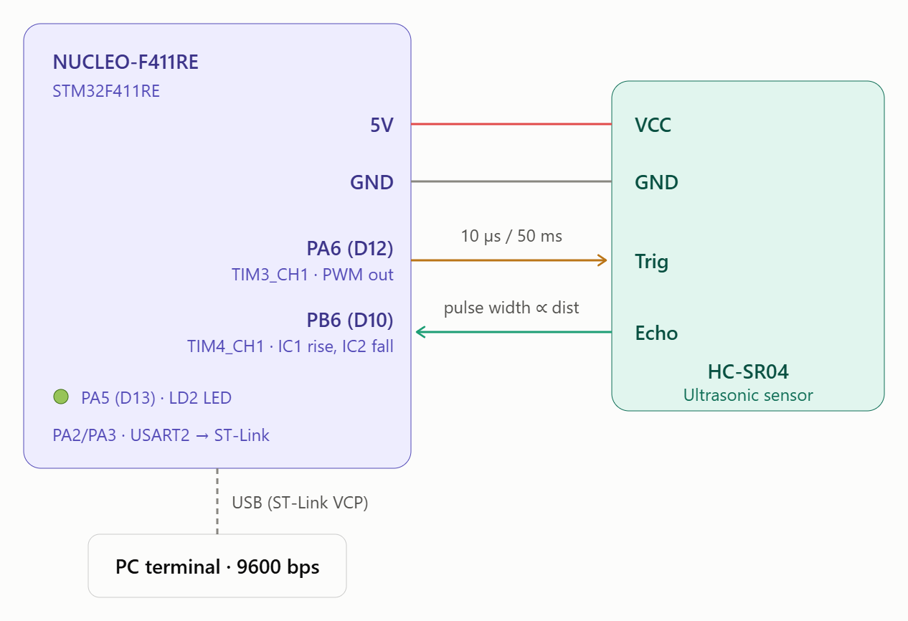
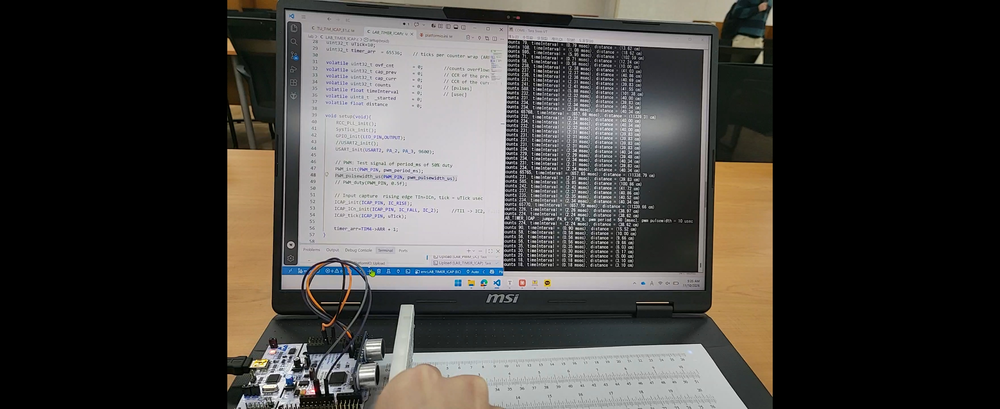
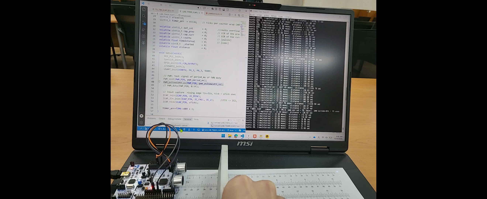
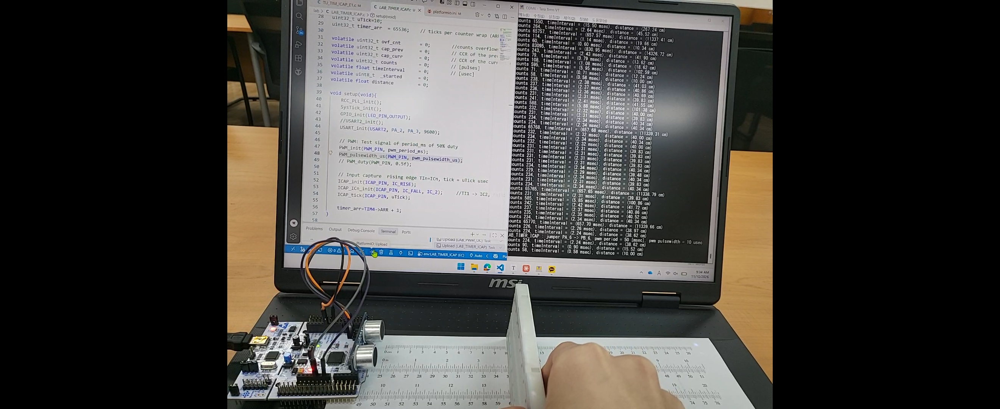

# LAB: Input Capture - Ultrasonic

**Date:** 2026-11-10

**Author/Partner:** Juyoung Lee

**Github:** [22200576-JUYOUNG-LEE/EC-STM32F4-22200576: Firmware for STM32F4, Embedded Controller, HGU](https://github.com/22200576-JUYOUNG-LEE/EC-STM32F4-22200576)

**Demo Video:** [[EC 26-2\] LAB(TIMER_ICAP)](https://www.youtube.com/watch?v=E4EhKPVMrlg&feature=youtu.be)

## Introduction

Create a simple program that uses input capture mode to measure the distance using an ultrasonic distance sensor. The sensor also needs trigger pulses that can be generated by using the timer output.

### Requirement

#### Hardware

* MCU
  * NUCLEO-F411RE
* Actuator/Sensor/Others:
  * HC-SR04
  * breadboard

#### Software

* Keil uVision, CMSIS, EC\_HAL library

***

## Problem: Ultrasonic Distance Sensor (HC-SR04)

The HC-SR04 ultrasonic distance sensor. This economical sensor provides 2cm to 400cm of non-contact measurement functionality with a ranging accuracy that can reach up to 3mm. Each HC-SR04 module includes an ultrasonic transmitter, a receiver and a control circuit.


**The HC-SR04 Ultrasonic Range Sensor Features:**

* Input Voltage: 5V
* Current Draw: 20mA (Max)
* Digital Output: 5V
* Digital Output: 0V (Low)
* Sensing Angle: 30° Cone
* Angle of Effect: 15° Cone
* Ultrasonic Frequency: 40kHz
* Range: 2cm - 400cm

### Distance Measurement

The program needs to

* Generate a trigger pulse as PWM to the sensor.
* Receive echo pulses from the ultrasonic sensor
* Measure the distance by calculating pulse-width of the echo pulse.
* Display measured distance in \[cm] on serial monitor of Tera-Term for

  (a) 10mm (b) 50mm (c) 100mm

### Configuration

| System Clock | PWM                                                 | Input Capture                                                |
| ------------ | --------------------------------------------------- | ------------------------------------------------------------ |
| PLL (84MHz)  | PA6 (TIM3\_CH1)                                     | PB6 (TIM4\_CH1)                                              |
|              | <p>AF, Push-Pull,<br>No Pull-up Pull-down, Fast</p> | AF, No Pull-up Pull-down                                     |
|              | <p>PWM period: 50msec<br>pulse width: 10usec</p>    | <p>Counter Clock : 0.1MHz (10us)<br>CH1 -> TI1 -> IC1 (rising edge)<br>CH1 ->TI1 -> IC2 (falling edge)</p> |

### Circuit Diagram 



### Discussion

1. There can be an over-capture case, when a new capture interrupt occurs before reading the CCR value. When does it occur and how can you calculate the time span accurately between two captures?

> **When it occurs:**
>  Over-capture happens when a new edge arrives on the same channel before the previous CCR value has been read, that is, while CCxIF is still 1. The CCR is overwritten, the previous capture is lost, and the over-capture flag (CCxOF) is set. This occurs when the period of the input signal is shorter than the sum of the interrupt latency and the ISR execution time. For example:
>
> - the input signal frequency is high,
> - a higher-priority interrupt delays the ISR,
> - the ISR takes a long time (e.g., `printf` inside the ISR),
> - noise produces short false edges.
>
> **How to calculate the time span accurately:**
>
> - Compute the time span as **time span = t_tick × [(CCR_now − CCR_prev) + OVC × (ARR+1)]**.
> - In the ISR, check CCxOF. If it is set, discard the measured value, clear CCxOF, and measure again from the next valid edge.
> - Keep the ISR short: read the CCR as soon as the ISR is entered, and do the calculation and printing in the main loop.
> - For high-frequency signals, use the input prescaler (ICPSC = /2, /4, /8) to capture only every N-th edge, then divide the result by N. Use the input filter (ICF) to reject noise.

2. In the tutorial, what is the accuracy when measuring the period of 1Hz square wave? Show your result.

> [Result of TU_TIM_ICAP_E1]
>
> ICAP_tick = 100 [us]
>
> counts 9999, timeInterval = (999.90 msec)
> counts 10000, timeInterval = (1000.00 msec)
> counts 10000, timeInterval = (1000.00 msec)
>
> ICAP_tick = 10 [us]
> counts 0, timeInterval = (0.00 msec)
> counts 99997, timeInterval = (999.97 msec)
> counts 100000, timeInterval = (1000.00 msec)
> counts 100000, timeInterval = (1000.00 msec)
>
> A 1 Hz, 50 % duty PWM signal on PA6 (TIM3_CH1) was measured with input capture on PB6 (TIM4_CH1), using rising-to-rising edges. The measurement was done with two tick settings.
>
> |                         | uTick = 100 µs      | uTick = 10 µs        |
> | ----------------------- | ------------------- | -------------------- |
> | Expected counts         | 10,000              | 100,000              |
> | Measured (steady state) | 10,000 (1000.00 ms) | 100,000 (1000.00 ms) |
> | Resolution              | ±0.01 %             | ±0.001 %             |
> | Error                   | 0 % (within 1 tick) | 0 % (within 1 tick)  |
>
> - **Accuracy:** Every steady-state reading was exactly 1000.00 ms, so the accuracy is limited only by the tick resolution. A smaller tick gives higher accuracy.
> - **Overflow handling:** With a 10 µs tick, the counter wraps every 655 ms, so one overflow occurs in every period. The counts were still correct, which confirms the overflow compensation `(CCR_now − CCR_prev) + OVC × (ARR+1)` works.
> - **First reading:** Only the first value was off, by 1–3 ticks. This is a start-up transient from timer initialization, so it was excluded.
> - **Limitation:** The PWM and ICAP timers share the same system clock, so any clock error cancels out. The result therefore shows relative accuracy only. Absolute accuracy has to be checked against an external reference such as an oscilloscope.

3. Limitation at short distance (10 mm)

   > The sensor could not measure the 10 mm (1 cm) target correctly. As the object approached the sensor, the reading did not go below about **3.1 cm (18 counts = 180 µs)**, even when the actual distance was 1 cm. This is because 10 mm is below the sensor’s minimum range. The datasheet specifies 2 cm, and in practice the limit was about 3 cm. There are three reasons:

### Code

#### Overview

The program has three parts.

1. **Trigger (PWM output):** TIM3_CH1 on PA6 generates a 10 µs HIGH pulse every 50 ms. This is the trigger signal of the HC-SR04.

2. **Echo (input capture):** The echo signal enters PB6 (TIM4_CH1). The same input TI1 is routed to two capture channels.

   - IC1 captures the **rising edge** (start of the echo pulse).
   - IC2 captures the **falling edge** (end of the echo pulse).

   The counter clock is 0.1 MHz, so 1 tick = 10 µs.

3. **Distance calculation:** The echo pulse width is converted to distance and printed to Tera Term every 2 s.

#### Pulse width and distance

The pulse width is calculated in `TIM4_IRQHandler()`, including counter overflows that occur during the pulse:

$$t_{echo}\,[\mu s] = t_{tick} \times \left[ (CCR_{fall} - CCR_{rise}) + OVC \times (ARR+1) \right]$$

Sound travels about 340 m/s, and the echo covers the round trip (2 × distance). So 1 cm corresponds to about 58 µs of echo time:

$$distance\,[cm] = \frac{t_{echo}\,[\mu s]}{58}$$

The overflow counter `ovf_cnt` is reset on the **rising edge** (start of the pulse). This way, only overflows that occur *during* the echo pulse are counted. Overflows during the idle LOW time are not added to the next measurement.

#### Main code

c

```c
#include "ecSTM32F4v2.h"

#define ICAP_PIN    PB_6        // TIM4_CH1 : echo input (input capture)
#define PWM_PIN     PA_6        // TIM3_CH1 : trigger output (PWM)
#define LED_PIN     PA_5        // LD2 : heartbeat LED

uint32_t pwm_period_ms     = 50;    // trigger period  [ms]
uint32_t pwm_pulsewidth_us = 10;    // trigger pulse   [us]

uint32_t uTick     = 10;            // ICAP counter tick [us] (0.1 MHz)
uint32_t timer_arr = 65536;         // ticks per counter wrap (ARR+1)

volatile uint32_t ovf_cnt      = 0; // number of counter overflows during the echo pulse
volatile uint32_t cap_prev     = 0; // CCR at rising edge  (IC1)
volatile uint32_t cap_curr     = 0; // CCR at falling edge (IC2)
volatile uint32_t counts       = 0; // echo pulse width [ticks]
volatile float    timeInterval = 0; // echo pulse width [us]
volatile float    distance     = 0; // measured distance [cm]

void setup(void){
    RCC_PLL_init();                         // System clock = 84 MHz (PLL)
    SysTick_init();                         // for delay_ms()
    GPIO_init(LED_PIN, OUTPUT);
    USART_init(USART2, PA_2, PA_3, 9600);   // printf -> Tera Term

    // Trigger : 10 us HIGH pulse every 50 ms on PA6 (TIM3_CH1)
    PWM_init(PWM_PIN, pwm_period_ms);
    PWM_pulsewidth_us(PWM_PIN, pwm_pulsewidth_us);

    // Echo : input capture on PB6 (TIM4_CH1)
    ICAP_init(ICAP_PIN, IC_RISE);               // TI1 -> IC1, rising edge
    ICAP_ICn_init(ICAP_PIN, IC_FALL, IC_2);     // TI1 -> IC2, falling edge
    ICAP_tick(ICAP_PIN, uTick);                 // counter tick = 10 us

    timer_arr = TIM4->ARR + 1;                  // ticks per overflow
}

int main(void){
    setup();
    printf("LAB_TIMER_ICAP : HC-SR04, trigger period = %lu ms, pulse width = %lu us\r\n",
           pwm_period_ms, pwm_pulsewidth_us);

    while(1){
        distance = timeInterval / 58.0f;        // [us] -> [cm]
        printf("counts %lu, echo = %.2f ms, distance = %.2f cm\r\n",
               counts, timeInterval / 1000.0f, distance);
        led_toggle(LED_PIN);                    // heartbeat
        delay_ms(2000);
    }
}

void TIM4_IRQHandler(void){
    // 1) Counter overflow : count wraps that occur during the echo pulse
    if(is_UIF(TIM4)){
        ovf_cnt++;
        clear_UIF(TIM4);
    }

    // 2) Rising edge (IC1) : start of the echo pulse
    if(is_CCIF(TIM4, IC_1)){
        cap_prev = ICAP_read(ICAP_PIN, IC_1);   // start time [ticks]
        ovf_cnt  = 0;                           // start counting overflows from here
        clear_CCIF(TIM4, IC_1);
    }

    // 3) Falling edge (IC2) : end of the echo pulse
    if(is_CCIF(TIM4, IC_2)){
        cap_curr = ICAP_read(ICAP_PIN, IC_2);   // end time [ticks]

        // pulse width = (end - start) + overflows * (ARR+1)
        counts       = (cap_curr - cap_prev) + (ovf_cnt * timer_arr);
        timeInterval = counts * uTick;          // [ticks] -> [us]

        clear_CCIF(TIM4, IC_2);
    }
}
```

### Results

Experiment images and results

> [Figure 1.1] 10mm - The Rangen of ultraconic sensor is 2cm - 400cm. So, Can't measure 10mm(1cm)
>
> 
>
> [Figure 1.2] 50mm(5cm)
>
> 
>
> [Figure 1.3] 100mm(10cm)
>
> 

**Demo Video**: [EC 26-2\] LAB(TIMER_ICAP)](https://www.youtube.com/watch?v=E4EhKPVMrlg)

## Reference

```
[1] STMicroelectronics, "RM0383 Reference manual: STM32F411xC/E advanced Arm®-based 32-bit MCUs," Rev. 4, May 2025. [Online]. Available: https://www.st.com
[2] STMicroelectronics, "PM0214 Programming manual: STM32 Cortex®-M4 MCUs and MPUs programming manual," Rev. 10, Mar. 2020. [Online]. Available: https://www.st.com
```
