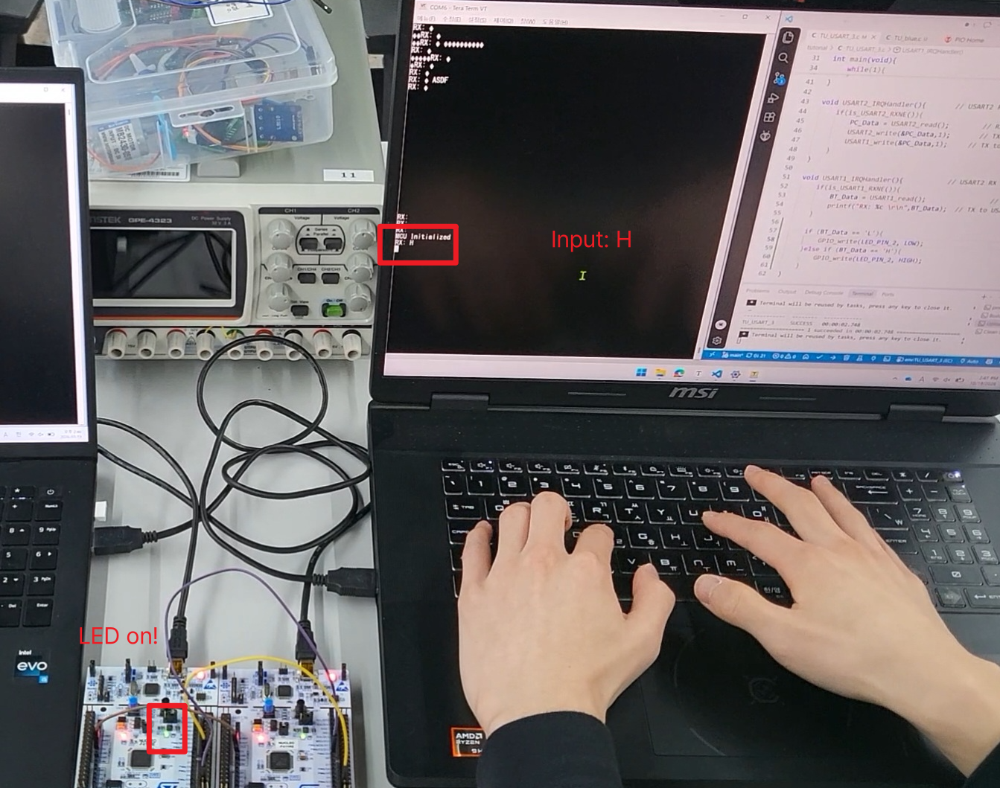
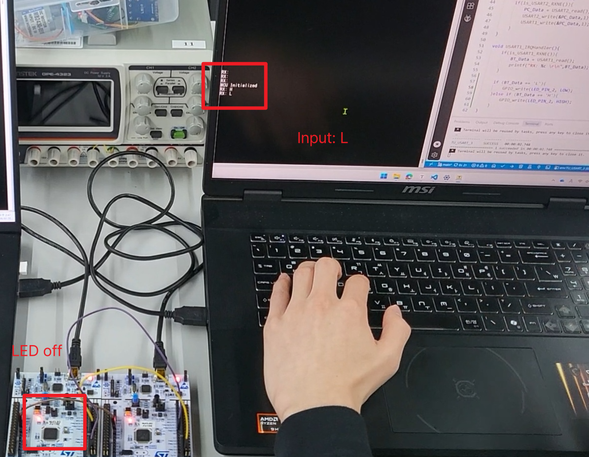
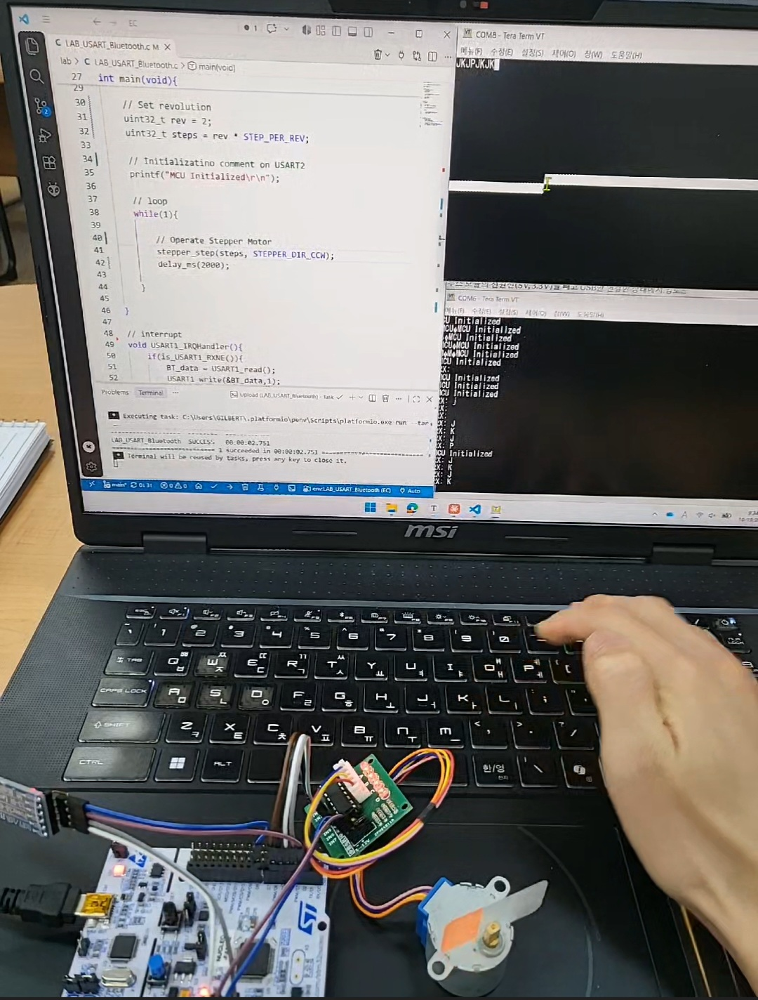

# LAB: USART - Bluetooth

**Date:** 2026-09-26

**Author/Partner:** Juyoung Lee

**Github:** [22200576-JUYOUNG-LEE/EC-STM32F4-22200576: Firmware for STM32F4, Embedded Controller, HGU](https://github.com/22200576-JUYOUNG-LEE/EC-STM32F4-22200576)

**Demo Video:** [[EC 26-2\] LAB(UART)](https://www.youtube.com/watch?v=oKHxA4iDR5U)

## Introduction

In this lab, we will learn how to configure and use ‘USART(Universal synchronous asynchronous receiver transmitter)’ of MCU. Then, we will learn how to communicate between your PC and MCU and MCU to another MCU with wired serial communication.

* **Mission 1**: Control LED(LD2) of other MCU using wired serial communication
* **Mission 2**: Control a stepper motor with wireless Bluetooth communication

### Requirement

#### Hardware

* MCU
  * NUCLEO-F411RE
* Actuator/Sensor/Others:
  * DC motor, DC motor driver(L9110s),
  * Bluetooth Module(HC-06),

#### Software

* Keil uVision, CMSIS, EC\_HAL library

## Problem 0: USART library

### Header File (`ecUART2.h`)

```c
/*----------------------------------------------------------------\
@ Embedded Controller by Young-Keun Kim - Handong Global University
Author           : Juyoung Lee
Created          : 10-08-2025
Modified         : 10-18-2026 
Language/ver     : C in VS Code

Description      : USART2  library 
/----------------------------------------------------------------*/

#ifndef __EC_USART2_STUDENT_H
#define __EC_USART2_STUDENT_H

#include <stdio.h>
#include <math.h>
#include "stm32f411xe.h"
#include "ecGPIO2.h"
#include "ecRCC2.h"


#define POL 0
#define INT 1

// You can modify this
#define BAUD_9600	9600
#define BAUD_19200	19200
#define BAUD_38400  38400
#define BAUD_57600	57600
#define BAUD_115200 115200
#define BAUD_921600 921600


// ********************** USART 2 (USB) ***************************
	// PA_2 = USART2_TX
	// PA_3 = USART2_RX
	// Alternate function(AF7), High Speed, Push pull, Pull up
	// APB1
// **********************************************************

// ********************** USART 1 ***************************
	// PA_9 = USART1_TX (default)	// PB_6  (option)
	// PA_10 = USART1_RX (default)	// PB_3 (option)
	// APB2
// **********************************************************

// ********************** USART 6 ***************************
	// PA_11 = USART6_TX (default)	// PC_6  (option)
	// PA_12 = USART6_RX (default)	// PC_7 (option)
	// APB2
// **********************************************************


/*================ EXERCISE ================*/
/*================ General Configuration ================*/
// General configuration
void USART_init(USART_TypeDef* USARTx, PinName_t pin_GPIO_TX, PinName_t pin_GPIO_RX, uint32_t baud);	// copy of USART_setting
void USART_baud(USART_TypeDef* USARTx, uint32_t baud);
void USART_pins(USART_TypeDef* USARTx, PinName_t pin_GPIO_TX, PinName_t pin_GPIO_RX);

void USART1_baud(uint32_t baud);
void USART2_baud(uint32_t baud);


/*================ PROVIDED  ================*/
/*================ Configuration for each USART ================*/
// Configuration UART 1, 2 using default settings
void USART1_init(void);
void USART2_init(void);

// USART write & read
void USART1_write(uint8_t* buffer, uint32_t nBytes);
void USART2_write(uint8_t* buffer, uint32_t nBytes);
uint8_t USART1_read(void);										
uint8_t USART2_read(void);	

// RX Inturrupt Flag USART1,2
uint32_t is_USART1_RXNE(void);
uint32_t is_USART2_RXNE(void);


/*================ General Configuration ================*/
void USART_clock_enable(USART_TypeDef* USARTx);
void USART_write(USART_TypeDef* USARTx, uint8_t* buffer, uint32_t nBytes);
uint8_t USART_read(USART_TypeDef * USARTx);										
uint32_t is_USART_RXNE(USART_TypeDef * USARTx);
void USART_delay(uint32_t us);  

								

#endif // __EC_USART2_STUDENT_H


```

### USART Pin Map

| USART  | TX (default / option) | RX (default / option) | AF   | Bus (PLL 84 MHz) | IRQn               |
| ------ | --------------------- | --------------------- | ---- | ---------------- | ------------------ |
| USART1 | `PA_9` / `PB_6`       | `PA_10` / `PB_3`      | AF7  | APB2 (84 MHz)    | `USART1_IRQn` (37) |
| USART2 | `PA_2`                | `PA_3`                | AF7  | APB1 (42 MHz)    | `USART2_IRQn` (38) |
| USART6 | `PA_11` / `PC_6`      | `PA_12` / `PC_7`      | AF8  | APB2 (84 MHz)    | `USART6_IRQn` (71) |

- USART2 (`PA_2`/`PA_3`) is connected to the ST-Link virtual COM port. `printf()` and `scanf()` are retargeted to USART2.
- Frame format: **8 data bits, no parity, 1 stop bit (8N1)**, oversampling ×16.


### General Configuration

#### `USART_init()`

Initializes a USART with the given TX/RX pins and baud rate. It configures the GPIO pins (AF), enables the peripheral clock, sets the frame format to 8N1, sets the baud rate, enables TX/RX, and enables the RXNE interrupt in the NVIC (priority 1).

```c
void USART_init(USART_TypeDef* USARTx, PinName_t pin_GPIO_TX, PinName_t pin_GPIO_RX, uint32_t baud);
```

- **Parameters:**

  - `USARTx`: USART peripheral — `USART1`, `USART2`, `USART6`
  - `pin_GPIO_TX`: TX pin of type `PinName_t` (e.g., `PA_9`)
  - `pin_GPIO_RX`: RX pin of type `PinName_t` (e.g., `PA_10`)
  - `baud`: Baud rate (e.g., `BAUD_9600`, `BAUD_115200`)

- **Note:** The RXNE interrupt is always enabled. The matching `USARTx_IRQHandler()` must be defined, or the MCU will hang in `Default_Handler` when data is received.

- **Example Code:**

  ```c
  USART_init(USART2, PA_2, PA_3, BAUD_115200);   // PC (USB)
  USART_init(USART1, PA_9, PA_10, BAUD_9600);    // Bluetooth module
  ```

#### `USART_baud()`

Calculates `USARTDIV` from the bus clock and writes the mantissa and fraction to `BRR`. USART2 uses APB1 (`EC_SYSCLK / 2`), and USART1/USART6 use APB2 (`EC_SYSCLK`).

```c
void USART_baud(USART_TypeDef* USARTx, uint32_t baud);
```

- **Formula:**

  - `USARTDIV = f_CK / (16 × baud)`
  - `BRR[15:4]` = Mantissa (integer part), `BRR[3:0]` = Fraction (× 16, rounded)

- **Parameters:**

  - `USARTx`: `USART1`, `USART2`, `USART6`
  - `baud`: Baud rate

- **Note:** This function disables the USART (`UE = 0`) and does **not** re-enable it. `USART_init()` enables it afterwards. When called alone, set `USARTx->CR1 |= USART_CR1_UE;` after it.

- **Example Code:**

  ```c
  USART_baud(USART1, BAUD_38400);
  USART1->CR1 |= USART_CR1_UE;   // re-enable USART1
  ```

#### `USART_pins()`

Configures the TX/RX pins as Alternate Function, Push-Pull, No Pull-up/Pull-down, High speed, and sets the AF number in `AFR` (AF7 for USART1/2, AF8 for USART6).

```c
void USART_pins(USART_TypeDef* USARTx, PinName_t pin_GPIO_TX, PinName_t pin_GPIO_RX);
```

- **Parameters:**

  - `USARTx`: `USART1`, `USART2`, `USART6`
  - `pin_GPIO_TX`, `pin_GPIO_RX`: TX/RX pins of type `PinName_t`

- **Example Code:**

  ```c
  USART_pins(USART1, PA_9, PA_10);
  ```

#### `USART1_baud()` / `USART2_baud()`

Wrapper functions of `USART_baud()` for USART1 and USART2.

```c
void USART1_baud(uint32_t baud);
void USART2_baud(uint32_t baud);
```

- **Parameters:**

  - `baud`: Baud rate

- **Example Code:**

  ```c
  USART2_baud(BAUD_115200);
  ```


###  Default Configuration for Each USART

#### `USART1_init()`

Initializes USART1 with default settings: `PA_9` (TX), `PA_10` (RX), 9600 baud, 8N1, RXNE interrupt enabled.

```c
void USART1_init(void);
```

- **Example Code:**

  ```c
  USART1_init();   // Bluetooth module at 9600 baud
  ```

#### `USART2_init()`

Initializes USART2 with default settings: `PA_2` (TX), `PA_3` (RX), 9600 baud, 8N1, RXNE interrupt enabled. USART2 is connected to the PC through the ST-Link USB.

```c
void USART2_init(void);
```

- **Example Code:**

  ```c
  USART2_init();
  printf("Hello\r\n");   // printed on PC terminal (9600 baud)
  ```


### Write & Read

#### `USART1_write()` / `USART2_write()`

Transmits `nBytes` from the buffer through USART1 or USART2 (blocking).

```c
void USART1_write(uint8_t* buffer, uint32_t nBytes);
void USART2_write(uint8_t* buffer, uint32_t nBytes);
```

- **Parameters:**

  - `buffer`: Pointer to the data to send
  - `nBytes`: Number of bytes to send

- **Example Code:**

  ```c
  uint8_t msg[] = "OK\r\n";
  USART1_write(msg, 4);
  
  uint8_t c = 'A';
  USART2_write(&c, 1);   // pass the address, not the value
  ```

#### `USART1_read()` / `USART2_read()`

Waits until one byte is received (RXNE = 1) and returns it (blocking). Reading `DR` clears RXNE.

```c
uint8_t USART1_read(void);
uint8_t USART2_read(void);
```

- **Return Value:** Received byte

- **Example Code:**

  ```c
  uint8_t data = USART1_read();
  ```

#### `is_USART1_RXNE()` / `is_USART2_RXNE()`

Checks if received data is ready in `DR` (non-blocking).

```c
uint32_t is_USART1_RXNE(void);
uint32_t is_USART2_RXNE(void);
```

- **Return Value:** `1` if data is received, `0` otherwise

- **Example Code:**

  ```c
  if (is_USART1_RXNE()) {
      uint8_t data = USART1_read();
  }
  ```


### Low-Level Functions

#### `USART_clock_enable()`

Enables the peripheral clock in RCC: USART1/USART6 in `APB2ENR`, USART2 in `APB1ENR`.

```c
void USART_clock_enable(USART_TypeDef* USARTx);
```

#### `USART_write()`

For each byte, waits until `TXE = 1` and writes it to `DR`. After the last byte, waits until `TC = 1` and clears TC.

```c
void USART_write(USART_TypeDef* USARTx, uint8_t* buffer, uint32_t nBytes);
```

#### `USART_read()`

Waits until `RXNE = 1` and returns the lower 8 bits of `DR`.

```c
uint8_t USART_read(USART_TypeDef* USARTx);
```

#### `is_USART_RXNE()`

Returns the RXNE flag of `SR` (`1` = data received).

```c
uint32_t is_USART_RXNE(USART_TypeDef* USARTx);
```

#### `USART_delay()`

Busy-wait delay in microseconds (approximate). Used between bytes in `USART_write()`.

```c
void USART_delay(uint32_t us);
```


### printf / scanf Retarget

`printf()` and `scanf()` are redirected to **USART2** (PC terminal).

- Keil (ARMCC): `fputc()` / `fgetc()`
- GCC: `_write()` / `_read()`

```c
USART2_init();                  // or USART_init(USART2, PA_2, PA_3, BAUD_9600);
printf("MCU Initialized\r\n");
```

- **Note:** Do not use `scanf()` / `USART2_read()` in `main` while `USART2_IRQHandler()` also reads `DR`. The ISR takes the byte first, and `main` waits forever.

### Header File (`ecUART2.c`)

```cpp
/*----------------------------------------------------------------\
@ Embedded Controller by Young-Keun Kim - Handong Global University
Author           : Juyoung Lee
Created          : 05-03-2021
Modified         : 10-09-2026
Language/ver     : C++ in VS Code

Description      : Stepper Motor Library. 
/----------------------------------------------------------------*/

#include "ecStepper2.h"


// Stepper Motor variable
static PinName_t stepperPins[4];
static volatile uint32_t _steps;
static volatile uint32_t _mode;
static volatile uint32_t _dir;
static volatile uint32_t _step_delay = 100;		
static const StateStepper_t *fsm;				// points at fsm_full or fsm_half (chosen in stepper_init)
static volatile uint32_t state = 0;				// current FSM state


// Output: A B A' B'
static const StateStepper_t fsm_Full[4] = {	
	{{S3,S1},{1,1,0,0}},		// A B A'B'
 	{{S0,S2},{0,1,1,0}},		// A B A'B'
 	{{S1,S3},{0,0,1,1}},		// A B A'B'
 	{{S2,S0},{1,0,0,1}},		// A B A'B'
};

static const StateStepper_t fsm_Half[8] = {  
	{{S7,S1},{1,0,0,0}},	
 	{{S0,S2},{1,1,0,0}},	
 	{{S1,S3},{0,1,0,0}},	
 	{{S2,S4},{0,1,1,0}},	
 	{{S3,S5},{0,0,1,0}},	
 	{{S4,S6},{0,0,1,1}},	
 	{{S5,S7},{0,0,0,1}},	
 	{{S6,S0},{1,0,0,1}},
};


// Initialization of Stepper Motor
void stepper_init(uint32_t mode, PinName_t *pinStepper){
	if (mode == STEPPER_MODE_HALF) 
		fsm = fsm_Half;
	else
		fsm = fsm_Full;

	_mode = mode;

	//  GPIO Digital Out Initiation
	// For A, B, AN, BN
	for (int i=0; i<4; i++){
		stepperPins[i] = pinStepper[i];
		GPIO_init(stepperPins[i],OUTPUT);
		GPIO_pupd(stepperPins[i],NO_PUPD);
		GPIO_otype(stepperPins[i],PUSH_PULL);
		GPIO_ospeed(stepperPins[i],SPEED_FAST);
	}

}

// Converts Motor [rpm] to step delay in [msec]
void stepper_speed (uint32_t speedRPM){      // rpm
	if(_mode == STEPPER_MODE_FULL) _step_delay = 60*1000/(STEP_PER_REV*speedRPM); 		//in [msec]	
	else _step_delay =  60*1000/(STEP_PER_REV*speedRPM) / 2; 				// delay of half
	// [usec] can be used for a higher accuracy
	// But needs delay_us() 
}


// Run Stepper Motor for given steps and direction
void stepper_step(uint32_t steps, uint32_t direction){
	// Exit if stepper_init() not called 

	if (fsm == 0) return;
	
	// Change step size 
	if(_mode == STEPPER_MODE_FULL) _steps = steps;
	else _steps = 2 * steps;

	// Choose direction 
	_dir = direction;


	// run for step size: 
	for (uint32_t i = 0; i < _steps; i++){					
		
		// Next State
		state = fsm[state].next[_dir];

		// Output of Present State
		stepper_out(state);
	
		// Delay for steppermotor speed
		delay_ms(_step_delay);
	}
}

// Stepper Motor Output for given state
void stepper_out(uint32_t state){
	
	// stepperPins[0]=A, stepperPins[1]=B, ...
	// out[0]=A, out[1]=B, ...

	GPIO_write(stepperPins[0], fsm[state].out[0]);
	GPIO_write(stepperPins[1], fsm[state].out[1]);
	GPIO_write(stepperPins[2], fsm[state].out[2]);
	GPIO_write(stepperPins[3], fsm[state].out[3]);
}


// Stop Stepper Motor
void stepper_stop(void) {
    _steps = 0;    
    
	// All pins(A,AN,B,BN) set as DigitalOut '0'
	GPIO_write(stepperPins[0], 0);
	GPIO_write(stepperPins[1], 0);
	GPIO_write(stepperPins[2], 0);
	GPIO_write(stepperPins[3], 0);
}


// Change direction of stepper
void stepper_dir(uint32_t direction){

	_dir = direction;
	
}
```


## Problem 1: Communicate MCU1-MCU2 using RS-232


### Procedure

1\. Create a new project under the directory **`EC\LAB\`**

* The environment name is “**LAB\_USART\_LED”.**
* Create a new source files named as “**LAB\_USART\_LED.c”**

2\. Make sure you updated the library in `\EC\include\` &#x20;

* **ecUART2.h, ecUART2.c**
* Also, update **ecSTM32F4v2.h**

3\. Connect each MCUs to each PC with **USART 2** via USB cable (ST-Link)

* MCU1 to PC1
* MCU2 to PC2

==4\. Connect MCU1 to MCU2 with **USART 1**==

* Connect RX/TX pins externally with jumper wires as
  * MCU1\_TX to MCU2\_RXD
  * MCU1\_RX to MCU2\_TX

5. Connect **GND pins** between MCU1-MCU2

6. Send a message from PC\_1 by typing keys on Teraterm.

7. The received message by MCU\_2 should be displayed on PC\_2.
8. Turn other MCU's LED(LD2) ON/OFF by :

* ==Press key "**L**" to Turn OFF LED==
* ==Press key "**H**" to Turn ON LED==

### Configuration

| Function                        | Port - Pin                   | Configuration                                                |
| ------------------------------- | ---------------------------- | ------------------------------------------------------------ |
| System Clock                    |                              | PLL 84MHz                                                    |
| USART2 : USB cable (ST-Link)    |                              | <p>No Parity, 8-bit Data,<br>1-bit Stop bit,<br>9600 baud-rate</p> |
| USART1 : MCU1,  MCU2            | <p>TXD: PA9<br>RXD: PA10</p> | <p>No Parity, 8-bit Data,<br>1-bit Stop bit,<br>9600 baud-rate</p> |
| <p>Digital Out: LD2<br><br></p> | <p>PA5<br><br></p>           |                                                              |

#### Code

**Description**

The same code runs on both MCUs. All receiving is done in the RX interrupts; transmitting is done by polling inside the ISRs.

- `setup()`: Sets the system clock to PLL 84 MHz and SysTick to 1 ms. Initializes USART2 (PC) and USART1 (other MCU) at 9600 baud, 8N1, with RXNE interrupts. Sets LD2 (PA5) as a digital output.
- `main()`: Prints "MCU Initialized" to the PC and then only waits (`delay_ms(2000)`). The main loop does no work; every action happens in the ISRs.
- `USART2_IRQHandler()`: Reads a key typed on the PC, echoes it back to the PC, and sends it to the other MCU through USART1.
- `USART1_IRQHandler()`: Reads the byte from the other MCU and prints it on the PC. `'H'` turns LD2 ON, and `'L'` turns it OFF.

Data flow: PC1 key → MCU1 USART2 RX → MCU1 USART1 TX → MCU2 USART1 RX → PC2 display + MCU2 LD2.

```c++
/*----------------------------------------------------------------\
@ Embedded Controller by Young-Keun Kim - Handong Global University
Author           : Juyoung Lee
Created          : 05-03-2021
Modified         : 10-21-2026 
Language/ver     : C++ in VS Code

Description      : UART P1, Communicate MCU1-MCU2 using RS-232
/----------------------------------------------------------------*/

#include "ecSTM32F4v2.h"
//#include "ecUART2.h" 

#define LED_PIN_2 PA_5

static volatile uint8_t PC_Data = 0;
static volatile uint8_t BT_Data = 0;
uint8_t PC_string[]="Loop:\r\n";

void setup(void){
	RCC_PLL_init();
	SysTick_init();
	
	// USART2: USB serial init
	USART2_init();  // default 9600
	//USART2_baud(BAUD_38400);
	
	// USART1: MCU2 serial init 
	USART1_init(); // default 9600
	//USART1_baud(BAUD_38400);

	// setting led
	GPIO_init	(LED_PIN_2, OUTPUT);   
	GPIO_pupd	(LED_PIN_2, PULL_UP);
	GPIO_otype	(LED_PIN_2, PUSH_PULL);
	GPIO_ospeed	(LED_PIN_2, SPEED_MEDIUM);


}

int main(void){	
	setup();
	printf("MCU Initialized\r\n");	
	while(1){
		// USART Receive: Use Interrupt only
		// USART Transmit: Polling
		//USART2_write(PC_string, 7);      
		delay_ms(2000);
		
	}
}

void USART2_IRQHandler(){       // USART2 RX Interrupt 
	if(is_USART2_RXNE()){
		PC_Data = USART2_read();		// RX from UART2 (PC)
		USART2_write(&PC_Data,1);		// TX to USART2	 (PC)	 Echo of keyboard typing
		USART1_write(&PC_Data,1);	  // TX to Other MCU
	}
}

void USART1_IRQHandler(){          	// USART2 RX Interrupt
	if(is_USART1_RXNE()){
		BT_Data = USART1_read();				// RX from other MCU UART1		
		printf("RX: %c \r\n",BT_Data); 	// TX to USART2(PC)
	}

	if (BT_Data == 'L'){
		GPIO_write(LED_PIN_2, LOW);
	}else if (BT_Data == 'H'){
		GPIO_write(LED_PIN_2, HIGH);
	}
}
```

#### Result

1. After reset, each MCU prints **“MCU Initialized”** on its PC terminal.
2. When the key **‘H’** is typed, the character is sent through USART1 to the other MCU. The receiving MCU prints **“RX: H”** on its terminal, and its LD2 (PA5) turns **ON**.
3. Typing **‘L’** turns the LED **OFF** in the same way. Other keys (e.g., “ASDF”) are only displayed and do not change the LED.

> **Figure 1.** Result of Problem 1 (MCU1–MCU2) Input High
>
> 
>
> **Figure 2.** Result of Problem 1 (MCU1–MCU2) input Low
>
> 

**Demo video**

 [demo video](https://youtu.be/oKHxA4iDR5U)

#### **Discussion**

**1. Broken characters caused by baud rate mismatch**

UART is asynchronous, so there is no clock line between the two devices. The receiver detects the falling edge of the start bit and then samples each bit at the timing set by its own baud rate. If the two sides use different baud rates, the receiver samples the bits at the wrong positions. It then reads wrong bit values or misses the stop bit, which causes a framing error. The wrong bytes are often outside the printable ASCII range, so Tera Term shows them as broken characters such as “◆”. Therefore, both MCUs and the terminal must use the same setting (9600 baud, 8N1). Noise on a floating RX pin, for example before the wires are connected, produces the same symptom. Setting the RX pin to pull-up prevents it.

**2. Signal level and common ground**

The connection between the two MCUs is not true RS-232. It is a **TTL-level UART** (0 V / 3.3 V). Real RS-232 uses ±3 to ±15 V and inverted logic (logic 1 = negative voltage). Connecting it directly to the MCU pins can damage them, so an RS-232 transceiver (e.g., MAX3232) is required. Also, UART reads each bit by comparing it to GND. Without a **common GND** between the two boards, the receiver cannot read the voltage levels correctly and communication fails. TX and RX must be **crossed** (TX → RX).


***

## Problem 2: Control Stepper Motor via Bluetooth


### Procedure

1\. Create a new project&#x20;

* The environment name is “**LAB\_USART\_Bluetooth”.**
* Create a new source files named as “**LAB\_USART\_Bluetooth.c”**

2\. Make sure your updated library in `include\` to your project.

* **ecUART2.h, ecUART2.c**
* Update **ecSTM32F4v2.h**

3\. Connect the MCU-BT module. Use USART 1

* Connect RX/TX pins as
  * **MCU\_TX to  BT\_RX**
  * **MCU\_ RX to BT\_TX**

4\.  Connect the BT module (HC-06) to the PC

5. Check the Bluetooth connection by turning MCU's LED(LD2) ON/OFF by sending text of "**L**" or "**H**" from the PC (serial terminal)
6. Connect a stepper motor to MCU  (**see Lab: Stepper**)&#x20;
7. Control Step motor by the Keyboard inputs

* Rotate the stepper motor 2 revolutions with an appropriate speed&#x20;
* Press 'J' : To run CW direction&#x20;
* Press 'K' : To run CCW direction
* Press 'P' : Emergency STOP


### Configuration

| Function                                         | Port - Pin                   | Configuration                                                |
| ------------------------------------------------ | ---------------------------- | ------------------------------------------------------------ |
| **System Clock**                                 |                              | PLL 84MHz                                                    |
| **USART1 : MCU -Bluetooth**                      | <p>TXD: PA9<br>RXD: PA10</p> | <p>No Parity, 8-bit Data,<br>1-bit Stop bit,<br>9600 baud-rate</p> |
| <p><strong>Digital Out: LD2</strong><br><br></p> | <p>PA5<br><br></p>           |                                                              |
| **Motor Pin A, B, A', B'**                       | PB10, PB4, PB5, PB3          | DOUT                                                         |
|                                                  |                              |                                                              |

#### Code

**Description**

- `setup()`: Sets the system clock to PLL 84 MHz and SysTick to 1 ms. Initializes the stepper motor (full step, PB10/PB4/PB5/PB3, 10 rpm) and USART1 (Bluetooth) / USART2 (PC) at 9600 baud with RXNE interrupts.
- `main()`: Prints "MCU Initialized" to the PC. In the loop, it rotates the motor 2 revolutions (`2 × STEP_PER_REV` = 4096 steps) and then waits 2 s.
- `USART1_IRQHandler()`: Reads a command from the Bluetooth module, echoes it back, and prints it on the PC. It changes the motor direction with `stepper_dir()` (`'J'`, `'K'`) or stops it with `stepper_stop()` (`'P'`).
- Because `stepper_step()` reads the `volatile` variables `_dir` and `_steps` at every step, a command received in the ISR takes effect immediately, even during rotation. `stepper_stop()` sets `_steps = 0`, so the step loop ends at once.

```c++
/*----------------------------------------------------------------\
@ Embedded Controller by Young-Keun Kim - Handong Global University
Author           : Juyoung Lee
Created          : 05-03-2021
Modified         : 10-01-2026 
Language/ver     : C++ in VS Code

Description      : Stepper motor P1.Rotate the stepper motor 5 revolutions with 1 rpm.
/----------------------------------------------------------------*/

#include "ecSTM32F4v2.h"


PinName_t pinStepper[4] = {PB_10,PB_4,PB_5,PB_3};

uint8_t PC_data = 0;
uint8_t BT_data = 0;

// setup
void setup(void){
    // 1.CLK, (RCC, Sysclock)
    // RCC_HSI_init();
    RCC_PLL_init();
    SysTick_init();

    // 2. steppermotor init
    stepper_init(STEPPER_MODE_FULL, pinStepper);
    stepper_speed(10);

    // 3. USART_1, 2, init
    USART1_init();
    USART2_init();
}


// main
int main(void){
    setup();

    // Set revolution 
    uint32_t rev = 2;
    uint32_t steps = rev * STEP_PER_REV;

    // Initializatino comment on USART2
    printf("MCU Initialized\r\n");

    // loop
    while(1){

        // Operate Stepper Motor
        stepper_step(steps, STEPPER_DIR_CCW);
        delay_ms(2000);

    }

}

// interrupt
void USART1_IRQHandler(){
    if(is_USART1_RXNE()){
        BT_data = USART1_read();
        USART1_write(&BT_data,1);
        printf("RX: %c \r\n",BT_data); // write on PC by USART2
        
        // Change stepper direction and stop
        if(BT_data == 'J') stepper_dir(STEPPER_DIR_CCW);
        else if(BT_data == 'K') stepper_dir(STEPPER_DIR_CW);
        else if(BT_data == 'P') stepper_stop();
    }
}

```

#### Result

The direction changed as soon as ‘J’ or ‘K’ was sent, and the motor stopped as soon as ‘P’ was sent. The received commands were displayed on the terminal as “RX: J”, “RX: K”, and “RX: P”.

> **Figure 3.** Result of Problem 2
>
> 

**Demo video** 

[demo video](https://youtu.be/oKHxA4iDR5U)

#### **Discussion**

**1. Need for non-blocking stepper control**

The stepper function from the previous lab, `stepper_step()`, is **blocking**. It uses a `for` loop with `delay_ms()`, so the CPU cannot do any other work until the rotation ends. In this lab, the direction was made a global `volatile` variable (`_dir`) and changed in the USART interrupt (`stepper_dir()`). This allowed the direction to change during rotation. However, the main loop calls `stepper_step(steps, CCW)` again after each rotation, so the CW and STOP commands are overwritten. A better design is **non-blocking**. `stepper_step()` should only store the command (steps, direction) and return immediately. A timer interrupt should then call an update function every step period to move the FSM by one step. This lets the main loop handle other tasks (UART, sensors, display) at the same time, and commands stay in effect until a new one arrives.


**2. Accuracy of motor speed**

`stepper_speed()` calculates the step delay in milliseconds with integer division: `60000 / (2048 × 10) = 2.93 ms`, which becomes **2 ms**. The actual speed is about **14.6 rpm** instead of 10 rpm. This is close to the maximum speed of the 28BYJ-48 in full-step mode, so the motor may vibrate or lose steps (stall). To control the speed accurately, the delay should be calculated in microseconds with a µs-resolution timer, or the motor should be run at a lower speed.

## Reference

Complete list of all references used (github, blog, paper, etc)

```
[1] STMicroelectronics, "RM0383 Reference manual: STM32F411xC/E advanced Arm®-based 32-bit MCUs," Rev. 4, May 2025. [Online]. Available: https://www.st.com
[2] STMicroelectronics, "PM0214 Programming manual: STM32 Cortex®-M4 MCUs and MPUs programming manual," Rev. 10, Mar. 2020. [Online]. Available: https://www.st.com
```

